---
aliasesaliases:
  - "11"
---
# C++网络高级

## 一  linux入门

### 1.1>C++环境的搭建ghghf

#### 1>环境搭建
#linux #环境 #gcc
1、安装g++编译环境、gcc编译环境

```bash
sudo yum install gcc
sudo yum install gcc-c++
```


### 1.2>sys库的使用

#### 1>man手册的解析以及使用方法

#man手册

#### 2>常用的内核提供的函数库 sys

#### 3>使用GDB程序

#GDB

break(b)

next(n)


#### 4> linux中库的概念（静态库与动态库）

#静态库与动态库

1, 为什么引入库


在上述案例中，主程序要是有的源程序代码，在add.cpp中，如果项目结束后，到了交付阶段，由于主程序的生成需要其他程序联合编
译，那么就要将源程序打包一起发给老板，这样该程序的开发者自身的价值就不大了，该项目的知识产权就很容易被窃取。为了保护我们
的知识产权，我们引入了库的概念。

2, 什么是库

库在linux中是一个二进制文件，它是由.cpp文件（不包含main函数）编译而来，其他程序如果想要使用该源文件中的函数时，只需在编译生成可执行程序时，链接上该源文件生成的库文件即可。库中存储的是二进制文件，不容易被窃取知识产权，做到了保护作用。

库在linux系统中分为两类，分别是静态库和动态库

windows:

​	***.lib:静态库

​	***.dll:动态库

linux:

​		***.a:静态库

​		***.so:动态库

[[gcc与g++命令主要区别#==gcc与g++命令主要区别==]]

3, 静态库及其制作使用

#静态库及其制作使用

```
概念:将一个***.cpp的文件编译生成一个lin***.a的二进制文件,当你需要使用该源文件中的函数时,只需要链接该库即可,后期可以直接调用
静态体现在:在使用g++编译程序时,会将你的文件和库最终生成一个可执行程序(把静态库也放入到可执行程序中),每个可执行程序单独拥有一个静态库,体积较大,但是,执行效率较高
```

3.1准备工作

add.h

```c
#ifndef _ADD_H_
#define _ADD_H_

int add(int m,int n);		//函数声明

#endif
```

add.cpp

```c
#include "add.h"
int add(int m, int n)
{
	return m+n;
}

```

main.cpp

```c
#include <iostream>
#include<stdio.h>
#include "add.h"
using namespace std;

int main(int argc ,const char *atgv[])
{
	cout << add(3,8) << endl;		//调用外部文件中的相关函数
	return 0;
}
```

3.2编译生成静态库

```
g++ -c ***.cpp -o ***.o		//只编译不链接生成二进制文件
ar -crs lib***.a ***.o		//编译生成静态库

如果有多个.o文件共同编译生成静态库 : ar -crs lib***.a ***.o	 xxx.o ....

ar:用于生成静态库的指令
c:用于创建静态库
r:将文件插入或者替换静态库中同名文件
s: 重置静态库索引
```

3.3使用静态库

```
g++ main.cpp -L 库的路径 -l库名 -I库的名字
```


4, 动态库及其制作使用

#动态库及其制作使用

```
概念:将一个***.cpp的文件编译生成一个lin***.so的二进制文件,当你需要使用该源文件中的函数时,只需要链接该库即可,后期可以直接调用
动态体现在:在使用g++编译程序时,会将你的文件和库中的相关函数的索引表一起生成一个可执行程序,每个可执行程序只拥有函数的索引表,当程序执行到对应函数时,会根据索引表,动态寻找相关库所在位置进行调用,体积较小,但是,执行效率较慢,但是可以多个程序共享同一个动态库,所以,动态库也叫共享库
```


4.1准备工作

add.h

```c
#ifndef _ADD_H_
#define _ADD_H_

int add(int m,int n);		//函数声明

#endif
```

add.cpp

```c
int add(int m, int n)
{
	return m+n;
}

```

main.cpp

```c
#include <iostream>
#include<stdio.h>
#include "add.h"
using namespace std;

int main(int argc ,const char *atgv[])
{
	cout << add(3,8) << endl;		//调用外部文件中的相关函数
	return 0;
}
```


4.2 编译生成动态库

```
g++ -fPIC -c ***.cpp -o ***.o		//编译生成二进制文件
g++ -shared ***.o -o lib***.so		//依赖于二进制文件生成一个动态库

上述两个指令可以合成—个指令
g++ -fPIC -shared ***.cpp -o lib***.so
```


4.3使用动态库

```
g++ main.cpp -L 库的路径 -l库名 -I库的名字
```


4.4 以上错误的解决方式

方式1：更改路径的宏

```
export LD_LIBRARY_PATH=库的路径
```

方法2：将自己的动态库放入到系统的库由数目录中(/lib64/usr/lib64）


#### 5>如何使用第三方库

1.c/c++语言默认是支持标准输入输出库的,但是其他的相关函数库需要第三方引入,并且,编译程序时,需要链接上对应的库

2.使用数学库:

```
 #include<math.h>
```


3.使用线程支持类库:包含include<pthread.h>


```c
#include<iostream>
#include<math.h>		//数学相关函数所在的头文件
#include<pthread.h>		//线程支持库的相关头文件
#include<unistd.h>
using namespace std;

//定义分支线程的线程体函数
void *task(void *arg)
{
	while(1)
	{
		cout << "hello world"<<end;
		sleep(1):		//休眠菡数
	}
}

int main(int argc, const char* targv[])
{
	pthread_t tid;	//定义一个线程号变量，用于存储创建出来的线程的线程号

	//创建线程
	if(pthread_create(&tid, NULL，task，NULL)I= 0)
	{
		cout << "pthread_create error" << endl;
	}
	//主线程
	while(1):
	
	return 0;
}
```


### 1.3Makefile文件和CMake文件

#Makefile

#### 1>Makefile文件

##### 1>什么是Makefile

```
用于工程项目管理的一个文本文件，文件名为Makefile的文本文件
Makefile可以大写，也可以小写，一般Makefile首字母使用大写
如果Makefile和makefi1e两个文件都存在，系统会默认使用小写的
```


#make

##### 2>什么是make

```
make是一个执行Makefile的工具，是一个解释器
用来对Makefile中的命令进行解析并执行一个shell指令
make这个指令在/usr/bin中
如果没有安装make	sudo yum install make
查看是否安装成功的指令:
make --version
```

##### 3>Makefile的用途

```
描述了整个工程的编译、链接规则
软件项目的自动化编译，相当于给软件编译写一份脚本文件
```

##### 4>学习Makefile的必要性

```
Linux/uinx环境下开发的必备技能
系统架构师、项目经理的核心技能
研究开源项目、Linux内核原码的必需品
加深对底层软件构造系统及过程的理解
```


##### 5>如何学习Makefile

1.理论基础

```
软件的构造过程、程序的编译和链接：预处理-->编译-->汇编-->链接
面向依赖的思想：
依赖一个.cpp文件的程序
可执行程序	<--依赖于-- .o文件 <--依赖于-- .s文件 <--依赖于-- .i文件 <--依赖于-- .cpp文件

一个依赖多个.cpp文件的程序
可执行程序	<--依赖于-- .o文件 <--依赖于-- .s文件 <--依赖于-- .i文件 <--依赖于-- .cpp文件
			|	<--依赖于-- .o文件 <--依赖于-- .s文件 <--依赖于-- .i文件 <--依赖于-- .cpp文件
			|	<--依赖于-- .o文件 <--依赖于-- .s文件 <--依赖于-- .i文件 <--依赖于-- .cpp文件
			|	<--依赖于-- .o文件 <--依赖于-- .s文件 <--依赖于-- .i文件 <--依赖于-- .cpp文件
```

2.项目编程基础

```
C++程序语言基础
c语言基础
多文件原码管理、头文件包含、函数声明与定义
```


##### 6>Makefile的工作过程

```
Makefile本身是面向依赖进行编写的
源文件	-->	编译	---->	目标文件	--->	链接	--->	可执行文件
hello.cpp	---->	hello.0	--->	hell
本质上一步就可以生成可执行程序，但是，由于在生成可执行程序时，可能会有多个文件进行参与，后期其他文件可能要进行更改，更改后，会影响
到可执行程序的执行，其他没有更改的文件也要参与编译，浪费时间
```


##### 7>第一个Makefile

1.编写一个文件


2.通过终端编译程序


3.使用Makefile


```
Makefile中的注释是以#开头
#语法格式：I
#目标：依赖
#	通过依赖生成目标的指令
#注意：指令前面必须使用同一个tab键隔开，不能使用多个空格顶过来
hello:hello.0
	g++ hello.0 -0 hello

hello.o:hello.s
	g++ -c hello.s -0 hello.0

hello.s:hello.1
	g++ -S hello.1 -0 hello.s

hello.i:hello.cpp
	q++ -E hello.cpp -o hello.1
```

简化的Makefile文件

```
hello:hello.0
	g++ hello.0 -0 hello
	
hello.o:hello.cpp
	g++ -c hello.cpp -o hello.o
```


4.执行Makefile文件

```
 make	--->默认找到Makefile中的第一个目标开始进行执行
 make 目标	--->找到对应的目标进行执行
```

```
hello:hello.0
	g++ hello.0 -0 hello
	
hello.o:hello.cpp
	g++ -c hello.cpp -o hello.o
//此处一个规则是没有依赖，只有目标和指令
clean:
	rm hello.o hello
```


#Makefile 
##### 8>Makefile的语法规则

==1.规则==

构成Makefile的基本单元，构成依赖关系的核心部件
其他内容可以看做为规则的服务

==2、变量==
类似于C++中的宏，使用变量：

```
$(变量名）或者${变量名}
```

作用：使得Makefile更加灵活
3、条件执行
根据某一变量的值来控制make执行或者忽略Makefile的某一部分
4、函数 
文本处理函数:字符串的替换、查找、过滤等待

文件名的处理:读取文件/目录名、前后缀等待

5.注释

Makefile中的注释,是以#号开头


##### 9>规则

1、规则的构成：目标、目标依赖、命令
2、语法格式

```
目标:目标依赖
	命令


注意事项:
	命令必须使用tab键开头，一般是shel1指令
	一个规则中，可以无目标依赖，仅仅是实现某种操作
	一个规则中可以没有命令，仅仅描述依赖关系
	一个规则中，必须要有一个目标
```


3.目标详解

1)默认目标

```
一个Makefi1e里面可以有多个目标，一般会选择第一个当做默认目标
也就是make默认执行的目标
```


2)多目标

一个规则中可以有多个目标,多个目标具有相同的生成命令和依赖文件

```
aaa bbb clean distclean:
	rm hello.[^cpp] hello
```


3)多目标规则

多个目标可以是同一目标

```
all:testl
all:test2
testl:
echo "hello"
test2:
echo "world"
```


4)伪目标


```
并不是一个真正的文件名，可以看做是一个标签
无依赖，相比一般文件，不会重新生成、执行
伪目标：可以无条件执行，相当于对应的指令

	.PHONY:clean	#设置伪目标
	clean:
	rm hello.[Acpp] hello
```


4.目标依赖
1)文件时间戳

```
根据时间戳来判断目标依赖是否要进行更新
所有文件都更改过,则对所有文件进行编译,生成可执行程序
在上次make之后修改过的cpp文件,会被重新编译
在上次make只写修改过的头文件，依赖该头文件的目标依赖也会重新编译
```

2)模式匹配

```
%		--->通配符匹配
$@		--->目标
$^		--->依赖
$<		--->第一个依赖
*		--->普通通配符

%是makefile中的规则通配符,*是普通tong
```


## 二	标准IO与文件IO(外部文件操作)

### 一、标准IO与文件IO的区别

#### 1.1	IO概念

1>	 IO：顾名思义就是输入输出，程序与外部设备进行信息交换的过程称为IO操作
		2>	最先接触的iO：#include<stdio.h>标准的**缓冲**输入输出头文件

#### 1.2	IO的分类

1>	标准IO: 使用系统提供的库函数实现

2>    文件IO: 基于系统调用完成,每进行一次系统调用,进程会从用户空间向内核空间进行一次切换,当用户空间与内核空间进行切换时,进程就会进入一次挂起状态,从而导致进程执行效率低

3>	文件IO与标准IO的区别:	标准IO相比于文件IO而言,提供了缓冲区,用户可以将数据先放入缓冲区,等到缓冲区时机到了后,统一进行一次系统调用,将数据刷入内核空间

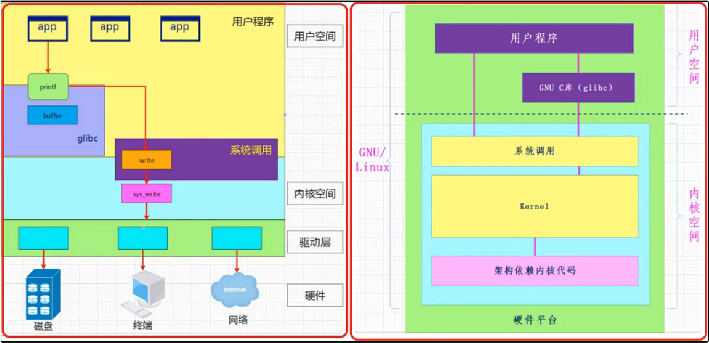

4>	标准IO接口: printf/scanf , fopen/fclose , fgetc/fputc , fgets/fputs , fprintf/fscaf,  fseek/ftell/rewind,  fread/fwrite

​		文件IO接口: open/close , read/write , lseek

### 二、标准IO

#### 2.1	标准IO实现原理

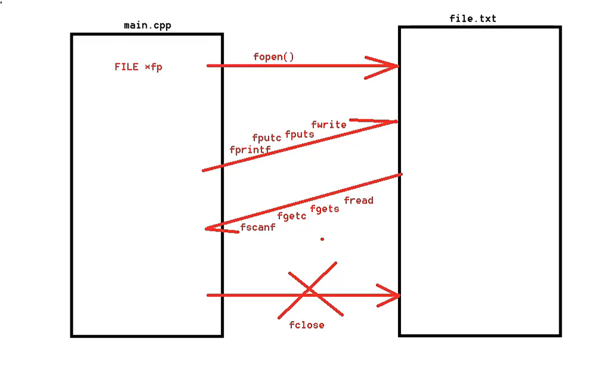

#### 2.2	FILE结构体的介绍

1>	FILE结构体是系统提供的用于描述一个文件全部信息的结构体

2>	FILE结构体的原型

```
srtuct FILE
{
	char * _IO_buf_base;		//缓冲区的起始地址
	char * _IO_buf_end;			//缓冲区终止地址
	
	int _fileno;			//文件描述符,用于进行系统调用

}
```

3>	特殊的FILE指针,这三个指针,全都是针对于终端文件而言的

stderr: 标准出错指针

stdin: 标准输入指针

stdout: 标准输出指针

#### 2.3	打开文件: fopen

```
	#include <stdio.h>		//该函数所在的头文件
	
	FILE *fopen(const char *path, const char *mode);
	功能: 打开一个文件,并返回当前文件的文件指针
	参数1: 表示文件路径,是一个字符串
	参数2: 打开文件的方式,也是一个字符串,字符串必须以下的字符开头
	The fopen() function opens the file whose name is the string pointed to by pathname and associates a stream with it.
    The argument mode points to a string beginning with one of the following sequences (possibly followed by additional characters, as described below):

       r      Open text file for reading.  The stream is positioned at the beginning of the file.
以只读的形式打开文件,文件光标定位在开头部分

       r+     Open for reading and writing.  The stream is positioned at the beginning of the file.
以读写的方式打开文件,文件光标定位在开头部分

       w      Truncate file to zero length or create text file for writing.  The stream is positioned at the beginning of the file.
以只写的方式打开文件,如果文件不存在,就创建文件,如果文件存在,就清空,光标定位在开头

       w+     Open for reading and writing.  The file is created if it does not exist, otherwise it is truncated.  The stream is positioned at the beginning of the file.
以读写的方式打开文件,如果文件不存在,就创建文件,如果文件存在,就清空,光标定位在开头

       a      Open for appending (writing at end of file).  The file is created if it does not exist.  The stream is positioned at the end of the file.
以追加(结尾写)的形式打开文件,如果文件不存在就创建文件,光标定位在文件末尾

       a+     Open  for reading and appending (writing at end of file).  The file is created if it does not exist.  Output is always appended to the end of the file.  POSIX is silent on what the initial read position is when using this mode.  For glibc, the initial file position for reading is at the beginning of the file, but for Android/BSD/MacOS, the initial file position for reading is at the end of  the file.
以读写的形式打开文件,如果文件不存在就创建文件,如果文件存在,读取操作光标定位在开头,写操作光标定位在结尾

返回值: 成功返回
```

```c++
#include"stdio.h"       //标准的输入输出文件


int main(int argc, const char *argv[])
{
    //1.定义一个文件指针
    FILE *fp = NULL;
    //以只读的形式打开一个不存在的文件,并将返回结果存入到fp指针中
    //fp = fopen("./file.txt","r");
    //此时会报错,原因是以只读的形式打开一个不存在的文件,如果文件存在就清空
    fp = fopen("./file.txt","w");
    if(fp == NULL)
    {
        printf("fopen error\n");
        return -1;
    }
    printf("fopen success\n");
    
    
    
    return 0;
}
```

#### 2.4 关闭文件: fclose

```
	 #include<stdio.h>
 
 	int fclose(FILE *stream);
	功能: 关闭指定的文件
 	参数: 要关闭的文件指针(由fopen返回的结果)
 	返回值: 成功执行返回0,失败返回EOF并置位错误码
```

```c++
#include "stdio.h" //标准的输入输出文件

int main(int argc, const char *argv[])
{
    // 1.定义一个文件指针
    FILE *fp = NULL;
    // 以只读的形式打开一个不存在的文件,并将返回结果存入到fp指针中
    // fp = fopen("./file.txt","r");
    // 此时会报错,原因是以只读的形式代开
    fp = fopen("./file.txt", "w");
    if (fp == NULL)
    {
        printf("fopen error\n");
        return -1;
    }
    printf("fopen success\n");

    // 2.关闭文件
    fclose(fp);

    return 0;
}
```

#### 2.5	关于错误码的问题

#错误码#错误信息

1>	概念: 当内核提供的函数出错后,内核空间会向用户空间反馈一个错误信息,由于错误信息比较多也比较杂,系统就给不同的错误信息起了一个编号,用一个整数表示,这个整数就是错误码

2>	错误码都是大于或等于0的数字:

```
#define EPERM            1      /* Operation not permitted */	操作受限
#define ENOENT           2      /* No such file or directory */	没有当前文件或目录
#define ESRCH            3      /* No such process */	没有进程
#define EINTR            4      /* Interrupted system call */	中断系统调用
#define EIO              5      /* I/O error */
#define ENXIO            6      /* No such device or address */
#define E2BIG            7      /* Argument list too long */
#define ENOEXEC          8      /* Exec format error */
#define EBADF            9      /* Bad file number */
#define ECHILD          10      /* No child processes */
#define EAGAIN          11      /* Try again */
#define ENOMEM          12      /* Out of memory */
#define EACCES          13      /* Permission denied */
#define EFAULT          14      /* Bad address */
#define ENOTBLK         15      /* Block device required */
#define EBUSY           16      /* Device or resource busy */
#define EEXIST          17      /* File exists */
#define EXDEV           18      /* Cross-device link */
#define ENODEV          19      /* No such device */
#define ENOTDIR         20      /* Not a directory */
#define EISDIR          21      /* Is a directory */
#define EINVAL          22      /* Invalid argument */
#define ENFILE          23      /* File table overflow */
#define EMFILE          24      /* Too many open files */
#define ENOTTY          25      /* Not a typewriter */
#define ETXTBSY         26      /* Text file busy */
#define EFBIG           27      /* File too large */
#define ENOSPC          28      /* No space left on device */
#define ESPIPE          29      /* Illegal seek */
#define EROFS           30      /* Read-only file system */
#define EMLINK          31      /* Too many links */
#define EPIPE           32      /* Broken pipe */
#define EDOM            33      /* Math argument out of domain of func */
#define ERANGE          34      /* Math result not representable */
```

3>关于错误码的处理函数  (strerror,perror)

```
#include <error.h>
int errno;

//将错误码对应的错误信息转换处理
	#include <string.h>
	
	char *strerror(int errnum)
	功能: 将错误码转换位错误信息描述
	参数: 错误码
	返回值: 错误信息字符串描述
	
//只打印错误码对应的错误信息的函数(推荐)
	#include <stdio.h>
	
	voide perror(const char *s);
	功能: 输出当前错误码对应的错误信息
	参数:提示符号,会原样打印出来,并且会在提示数据后面加上冒号,并输出完后,自动换行
	返回值:无
```

```c++
#include "stdio.h"  	//标准的输入输出文件
#include <errno.h>  	//错误码所在的头文件
#include <string.h>     //字符串处理的头文件
int main(int argc, const char *argv[])
{
    // 1.定义一个文件指针
    FILE *fp = NULL;

    fp = fopen("./file.txt", "r");
    if (fp == NULL)
    {
        //printf("fopen error: %d,errmsg: %s\n", errno,strerror(errno));    //打印错误信息,并输出错误码2
        perror("fopen error");      //打印当前错误码对应的错误信息
        return -1;
    }
    printf("fopen success\n");

    // 2.关闭文件
    fclose(fp);

    return 0;
}
```

#### 2.6	单字符读写:  fputc/fgetc

```
	 #include <stdio.h>

     int fgetc(FILE *stream);
     功能:从指定文件中读取一个字符数据,并以无符号整数的形式返回
     参数:文件指针
     返回值:成功返回读取的字符对应的无符号整数,失败返回EOF并置位错误码
     
     
      #include <stdio.h>
      
      int fputc(int c,FILE *stream)
      功能: 将指定的字符C写入到stream指向的文件中
      参数1: 要写入的字符,对应的无符号整数
      参数2: 文件指针
      返回值: 成功返回写入字符对应的无符号整数,失败返回EOF并并置位错误码
```

```cpp
#include <stdio.h>

int main(int argc, const char *argv[])
{
    // 定义头文件指针
    FILE *fp = NULL;
    if ((fp = fopen("./file.txt", "w")) == NULL) // 以只写的形式打开一个文件
    {
        perror("fopen error");
        return -1;
    }
    // 使用程序对文件对文件进行读写操作(单个字符进行操作)
    // 本次操作的结果是在外部文件中显示HELP,说明每写入一次,文件光标都会向后偏移
    fputc('H', fp);
    fputc('E', fp);
    fputc('L', fp);
    fputc('P', fp);

    // 能否从该处读取数据?不可以,为什么?因为光标此时在文件结尾处,没有数据可以被读取
    // 关闭文件
    fclose(fp);
    // 再次以只读的方式打开文件
    if ((fp = fopen("./file.txt", "r")) == NULL)
    {
        perror("fopen error");
        return -1;
    }

    char ch = 0; // 将文件中的字符,搬运到终端上
    while (1)
    {
        ch = fgetc(fp); // 从fp指向的文件中光标位置处读取一个字符,并返回
        if (ch == EOF)
        {
            break; // 说明文件已经被全部读取了,可以退出循环
        }
        printf("%c",ch);
    }
    // 关闭文件
    fclose(fp);

    return 0;
}
```

#### 使用fgetch额fputc完成两个文件的拷贝工作,实现指令cp的功能:	cp srcfile destgile

```cpp
#include <stdio.h>

int main(int argc, const char *argv[])
{
    // 判断外部传参是否为3（程序名 + 源文件 + 目标文件）
    if(argc != 3){
        fprintf(stderr, "Usage: %s <source_file> <dest_file>\n", argv[0]);
        return -1;
    }

    //以只读的方式打开源文件,以只写的方式打开目标文件
    FILE *srcfp = NULL;
    FILE *destfp = NULL;
    if((srcfp = fopen(argv[1], "r")) == NULL )
    {
        perror("srcfp open error");
        return -1;
    }
    if((destfp = fopen(argv[2],"w")) == NULL )
    {
        perror("destfp open error");
        fclose(srcfp);  // 打开目标文件失败，关闭已打开的源文件
        return -1;
    }

    //将源文件中的内容复制到目标文件
    char ch = 0;
     while((ch = fgetc(srcfp)) != EOF){
        fputc(ch, destfp);
    }
    
    //关闭两个文件
    fclose(srcfp);
    fclose(destfp);

    return 0;
}
```


#### 2.7	字符串读写:fgets/fputs

```
	int fputs(const char *s,FILE *stream);
	功能:将指定的字符串,写入到指定的文件中
	参数1:要被写入的字符串
	参数2:文件指针
	返回值:成功返回本次写入字符的个数,失败返回EOF
	
	char *fgets(char *s, int size, FILE *stream)
	功能:从stream指向的文件中最多读取size-1个字符到s容器中,遇到回车或文件结束,会结束一次读取,并且会将回车放入容器,最后自动加上一个字符串结束标识'\0'
	参数1:字符数组容器起始地址
	参数2:要读取的字符个数,最多读取size-1个字符
	参数3:文件指针
	返回值:成功返回容器s的起始地址,失败返回NULL
	
```

```cpp
#include <stdio.h>
#include <iostream>
#include <string.h>
int main(int argc, const char *argv[])
{
    // 打开文件
    FILE *fp = NULL;
    if ((fp = fopen("./file.txt", "w")) == NULL)
    {
        perror("fopen error");
        return -1;
    }

    // 向文件中写入多个字符串
    char wbuf[128] = ""; // 定义一个字符数组
    while (1)
    {
        std::cin >> wbuf; // 从终端输入一个字符串
        // 将上述字符串写入文件中
        fputs(wbuf, fp);
        fputc('\n', fp);
        if (strcmp(wbuf, "quit") == 0) // strcmp:比较两个字符串是否一致,如果相等则返回0
        {
            break;
        }
    }

    // 关闭文件
    fclose(fp);


    if ((fp = fopen("./file.txt", "r")) == NULL)
    {
        perror("fopen error");
        return -1;
    }
    char rbuf[128] = "";
    while(1)
    {
        //从文件中读取数据到rbuf容器中
        char *res = fgets(rbuf,sizeof(rbuf),fp);
        if(res ==NULL){
            break;
        }
        printf("rbuf = %s\n",rbuf);     //将数据打印到终端上
    }


    
    //关闭文件
    fclose(fp);
    return 0;
}
```

#### 使用fgets额fputs完成两个文件的拷贝工作

#### 2.8 关于标准IO的缓冲区问题

1>缓冲区分为三种

​	行缓存: 和终端文件相关的缓冲区叫做行缓存, 行缓冲区的大小为1024字节，对应的文件指针：stdin、stdout

​	全缓存:和外界文件相关的缓冲区叫做全缓存，全缓冲区的大小为4096字节，对应的文件指针：fp

​	不缓存:和标准出错相关的缓冲区叫不缓存，不缓存的大小为0字节，对应的文件指针：stderr

```cpp 
#include <iostream>
#include <stdio.h>
using namespace std;
int main(int argc, const char *argv[])
{
    // 验证行缓存的大小为1024
    //  如果缓冲区没有被使用时，求出大小为0，只有被至少使用了一次后，缓冲区的大小就被分配了
    printf("行缓存区的大小: %d\n", stdout->_IO_buf_end - stdout->_IO_buf_base); // 行缓存的大小
    printf("行缓存区的大小: %d\n", stdout->_IO_buf_end - stdout->_IO_buf_base); // 1024

    printf("行缓存区的大小: %d\n", stdin->_IO_buf_end - stdin->_IO_buf_base);
    int num = 0;
    // scanf("%d",&num);            //从终端输入一个整数让如num变量中，类似于cin>>num
    cin >> num;                                                               // 使用了标准的输入缓冲区
    printf("行缓存区的大小: %d\n", stdin->_IO_buf_end - stdin->_IO_buf_base); // 1024

    // 验证全缓存的大小为4096
    FILE *fp = NULL;
    if ((fp = fopen("./aa.txt", "r")) == NULL)
    {
        perror("fopen error");
        return -1;
    }
    // 未使用全缓存时，大小为0
    printf("全缓存的大小为：%d\n", fp->_IO_buf_end - fp->_IO_buf_base);
    // 使用一次全缓存
    fgetc(fp);
    printf("全缓存的大小为：%d\n", fp->_IO_buf_end - fp->_IO_buf_base);

    // 验证不缓存的大小为0
    // 未使用不缓存时大小为0
    printf("不缓存的大小为：%d\n", stderr->_IO_buf_end - stderr->_IO_buf_base);
    // 使用一次不缓存
    perror("error");
    printf("不缓存的大小为：%d\n", stderr->_IO_buf_end - stderr->_IO_buf_base);

    return 0;
}
```

2>	缓冲区的刷新时机

行缓存的刷新时机:

```cpp
/*1、验证缓冲区如果没有达到刷新时机，就不会将数据进行桐新
printf("hello world");			//在终端上打印输出一个he1oWor1d，没有到缓冲区的刷新时机，就不会输出数据
while(1);				//阻塞程序不让证程结束
*/

/*2、当程序结中后，会新行缓州区
printf("hello world");
*/

/*3.当遇到换行时：会刷新行缓存
printf("hello world\n");
while(1);
*/

/*4.当输入输出发生切换时,也会刷新行缓存
int num =0;
printf("请输入>>>");			//向标准输出缓冲区中写入一组数据，没有换行符号
scanf("%d", &num);			  //cin >> num
*/

/*5,当关闭行缓存对应的文件指针时,也会刷新行缓存
printf("hello world");			//向标准输出缓冲区中写入数据，没有换行
fclose(stdout);					//关闭标准输出指针
while(1);
*/

/*6.使用fflush函数手动刷新缓冲区时,也会刷新行缓存
printf("hello world");
fflush(stdout);
while(1);
*/

/*7.当缓冲区满了后,会刷新行缓存,行缓存大小:1024字节
for(int i=0;i<1025;i++)
{printf("A");}
while(1);			//防止程序结束
*/


```

全缓存的刷新时机:

```cpp
/*1、当缓冲区刷新时机未到时，就不会刷新全缓冲
fputs("hello world",fp);		//将字符串写入到文件中
while(1);				//阻塞程序不让程序结束
*/

/*2、当程序结中后，会刷新全缓存
fputs("hello world",fp);
*/

/*3.当遇到换行时,不会刷新全缓存
fputs("hello world\n",fp);
while(1);
*/

/*4.当输入输出发生切换时,会刷新全缓存
fputs("hello world",fp);
fgetc(fp);	
while(1);
*/

/*5,当关闭行缓存对应的文件指针时,会刷新全缓存
fputs("hello",fp)		//向标准输出缓冲区中写入数据，没有换行
fclose(stdout);					//关闭标准输出指针
while(1);
*/

/*6.使用fflush函数手动刷新缓冲区时,也会刷新全缓存
fputs("hello",fp)
fflush(stdout);
while(1);
*/

/*7.当缓冲区满了后,会刷新行缓存,行缓存大小:1024字节
for(int i=0;i<4097;i++)
{printf("A");}
while(1);			//防止程序结束
*/


```

对于不缓存的刷新时机，只要放入数据，立马进行刷新

#### 2.9	格式化读写: fprintf/fscanf

```
int fprintf(FILE *stream, const char *format, ...);
功能:向指定的文件中输出一个格式串
参数1: 文件指针
参数2: 格式串,可以包含控制符,%d(整数)%s(字符串)%f(小数)%lf(小数)
参数3: 可变参数,输出项列表,参数个数由参数2中的格式控制符的个数决定
返回值: 成功返回输出的字符个数,失败返回一个负数

int fscanf(FILE *stream, const char *format, ...);
功能:从指定的文件中以指定的格式读取数据,放入程序中
参数1: 文件指针
参数2: 格式串,可以包含控制符,%d(整数)%s(字符串)%f(小数)%lf(小数)
参数3: 可变参数,输出项地址列表,参数个数由参数2中的格式控制符的个数决定
返回值: 成功返回读入的项数,失败返回EOF并置位错误码
```


```cpp
#include <iostream>
#include <stdio.h>
using namespace std;
int main(int argc, const char *argv[])
{
    // 向标准输出文件指针中写入数据
    fprintf(stdout, "%d %lf %s\n", 520, 3.14, "ISODAJ");

    // 向标准输入中读取数据到程序中
    int num = 0;
    fscanf(stdin, "%d", &num); // 从标准输入缓冲区中以%d的格式读取一个整数
    printf("num = %d\n", num); // 1314

    // 对外部文件进行格式化读写
    FILE *fp = NULL;
    if ((fp = fopen("./usr.txt", "w")) == NULL)
    {
        perror("fopen error");
        return -1;
    }

    // 向文件中写入数据
    fprintf(fp, "%s %d", "admin", 123456); // 将两个不同的数据存放到文件中

    // 关闭文件
    fclose(fp);

    if ((fp = fopen("./usr.txt", "w")) == NULL)
    {
        perror("fopen error");
        return -1;
    }
    char usrname[20] = "";              // 存放用户名
    int pwd = 0;                        // 存放密码
    fscanf(fp, "%s %d", usrname, &pwd); // 从外部文件中分别读取一个字符串和一个整数放入程序中
    printf("usrname = %s,pwd = %d",usrname,pwd);
    
    //
    fclose(fp);

    return 0;
}
```

#### 练习：使用fprintf和fscanf完成注册和登录功能，要求做个小菜单，三个功能，

功能1是注册，用户输入账号和密码后，将其存放到外部文件中；

功能2是登录，用户输入登录账号和密码后，如果跟文件中匹配，则提示登陆成功，如果全部不匹配，则提示登录失败；

功能3表示退出。菜单可以循环调用

#### 2.10	格式串转字符串存入字符数组中: sprintf/snprintf

1>printf是向终端打印一个字符串,fprintf是向外部文件打印一个字符串

2>想要将多个不同数据类型的数据,组成一个

```
		int sprintf(char *restrict str,const char *restrict format, ...);
		功能: 将指定的格式串转换为字符串,放入字符数组中
		参数1:字符数组的起始地址
		参数2:格式串,可以包含多个格式控制符
		参数3:可变参数
		返回值: 成功返回转换的字符个数,失败返回EOF
		
		对于上述函数而言,用一个小的容器去存储一个大的转换后的字符串时,会出现指针越界的错误,为了安全起见,引入了snprintf
		
		int snprintf(char str[restrict .size], size_t size,const char *restrict format, ...);
		功能: 将格式串中最毒size-1个字符串转换为字符串,存放到转换数组中
		参数1:字符数组的起始地址
		参数2:要转换的字符个数,最多为size-1
		参数3:格式串,可以包含多个格式控制符
		参数4:可变参数
		返回值:如果转换的字符小于size时,返回值就是成功转换字符的个数,如果大于size则只转换size-1个字符,返回值就是size,失败返回EOF
		
```

```cpp
#include <iostream>
#include <stdio.h>
using namespace std;
int main(int argc, const char *argv[])
{
    char buf[128]; // 定义一个字符串容器

    // 将多种数据类型的数据连接成一个字符串,放入字符数组中
    // sprintf(buf, "%d %s %lf", 100, "xqkk", 99.5);

    // 安全起见,我们使用snprintf
    snprintf(buf, sizeof(buf), "%d %s %lf", 100, "xqkk", 99.5);
    // 输出转换后的字符串
    printf("%s", buf);
    return 0;
}
```

#### 2.11	模块化读写	(fread/fwrite)

```
		size_t fread(void ptr[restrict .size * .nmemb],size_t size,size_t nmemb,FILE *restrict stream);
		功能:从stream指向的文件中,读取nmemb项数据,每一项的大小为size,将整个结果放入ptr指向的容器中
		参数1:容器指针,是一个void*类型,表示可以存储任意类型的数据;
		参数2:要读取数据每一项的大小
		参数3要读取数据的项数
		参数4:文件指针
		返回值:成功返回nmemb,就是成功读取的项数,失败返回小于项数的值,或者是0
		size_t fwrite(const void ptr[restrict .size * .nmemb],size_t size, size_t nmemb,FILE *restrict stream);
		功能:从stream指向的文件中,写入nmemb项数据,每一项的大小为size,数据的起始地址是ptr
		参数1:要写入数据的起始地址
		参数2:每一项的大小
		参数3:要写入的总项数
		参数4:文件指针
		返回值:成功返回写入的项数,失败返回小于项数的值,或者是0
```

1>字符串的读写

```

```

2>整数的读写

```

```

3>结构体的读写

```

```

#### 2.12	文件光标:fseek/ftell/rewind

```
		int fseek(FILE *stream, long offset, int whence);	
		功能:移动文件光标位置,将光标从指定位置处进行前后偏移
		参数1:文件指针
		参数2:偏移量
			>0:表示从指定位置向后偏移n个字节
			<0:表示从指定位置向前偏移n个字节
			=0:在指定位置处不偏移
		参数3:偏移的起始位置
			SEEK_SET:文件起始位置
			SEEK_CUR:文件指针当前位置
			SEEK_END:文件结束位置
		返回值:成功返回0,失败返回-1并置位错误码
		
		long ftell(FILE *stream);
		功能:获取文件指针当前的偏移量
        参数:文件指针
        返回值:成功返回文件指针所在的位置,失败返回-1并置位错误码
        eg:fseek(fp,0,SEEK_END);	//将光标定位在结尾
        	ftell(fp);				//该函数的返回值,就是文件大小
		void rewind(FILE *stream);
		功能:将文件光标定位在开头:fseek(fp,0,SEEK_ENT);
		参数:文件指针
		返回值:无
```

```
#include <iostream>
#include <stdio.h>
using namespace std;
int main(int argc, const char *argv[])
```


#### 补充知识:

关于追代码工具ctags的使用

> ```
> 1.安装ctags: sudo yum install ctags
> 2.进入 /usr/include 目录下,执行sudo ctags -R 指令
> 3.该目录下会多出一个tags的索引文件
> 4.追相关内容的指令:vi -t 内容
> 	继续先后追内容:ctrl + ]
> 	退出追代码工具: 底行模式下输入q,回车
> ```
>

```
2>vscode中关于自定义片段的设置
1、在vscode中使用组合键：ctrl+shift+p调出控制面板
2、输入user snippets回车
3、输入自定义片段文件名称，打开自定义文件
4、输入以下程序
"simple C++ Program": {
"prefix": "main",
"body": [
"#include<iostream>",
"using namespace std;"
"int main(int argc, const char *argv[])",
"{",
$1"
11
return 0;",
"}”
],
"description": "simple C++ program template"
子
```

```
3>补充___头文件中可以包含多个头文件内容
```

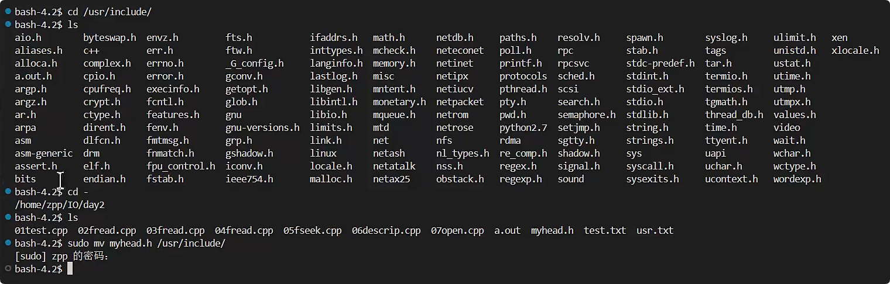


### 三、文件IO

就是通过系统调用(内核提供的函数)实现,只要使用的文件IO接口,那么进程就会从用户空间向内核空间进行一次切换.标准IO的实现中,也是在内部调用了文件IO操作.该操作效率较低,因为没有缓冲区的概念,文件IO常用的操作:open,close,read,write,lseek

#### 3.1文件描述符

1>文件描述符的本质是一个无符号整数,在使用open函数打开文件时,就会产生一个用于操作文件的句柄,这就是文件描述符

2>在一个进程中.能够打开的文件描述符是有限制的,一般是1024个,[0,1023],可以通过指令ulimit -a进行查看,如果要更改这个限制,可以通过指令ulimit-n数字，进行更改

3>文件描述符的使用原则一般是最小未分配原则,

4>特殊的文件描述符：0、1、2，这三个文件描述符在一个进程启动时就默认被打开了，分别表示标准输入、标准输出、标准错误

``` cpp
#include <iostream>
#include <stdio.h>
using namespace std;
int main(int argc, const char *argv[])
{
    // 分别输出标准输入、标准输出、标准出错文件指针对应的文件描述符
    printf("stdin->_fileno = %d\n", stdin->_fileno);  // 0
    printf("stdout->_fileno =%d\n", stdout->_fileno); // 1
    printf("stderr->_fileno =%d\n", stderr->_fileno); // 2
    return 0;
}
```

#### 3.2	打开文件open

```
	#include <fcntl.h>
	int open(const char *pathname, int flags);
	int open(const char *pathname, int flags, mode_t mode);
	功能：打开或创建一个文件，并返回该文件的文件描述符，返回文件描述符的规则是最小未分配原则
	参数1：要打开的文件文件路径
	参数2：打开模式
		以下三种方式必须选其一：O_RDONLY(只读)、O_WRONLY（只写）、O_RDWR（读写）
		以下的打开方式可以有零个或多个，跟上述的方式一起用位或运算连接到一起
		O_CREAT：用于创建文件，如果文件不存在，则创建文件，如果文件存在，则打开文件，如果f1ag中包含了该模式，则函数的第三个参数必须要加上
		O_APPEND：以追加的形式打开文件，光标定位在结尾
		O_TRUNC：清空文件
		O_EXCL：常跟O_CREAT一起使用，确保本次要创建一个新文件，如果文件已经存在，则open函数报错
		eg:
			"W"：O_WRONLY|O_CREAT|O_TRUNC
			"w+":O_RDWR|O_CREAT|O_TRUNC
			"r":O_RDONLY
			"r+": O_RDWR
			"a":O_WRONLY|O_CREAT|O_APPEND
			"a+": O_RDWR|O_CREAT|O_APPEND
		参数3:如果参数2中的f1ag中有O_CREAT时，表示创建新文件，参数3就必须给定，表示新创建的文件的权限
				如果当前参数给定了创建的文件权限，最终的结果也不一定是参数3的值，系统会用你给定的参数3的值，与系统的umask取反的值进行位与运算后，才是最终创建文件的权限（mode & ~umask）
				当前终端的umask的值，可以通过指令uumask来查看，一般默认为0022，表示当前进程所在的组中对该文件没有写权限，其他用户对该文件也没有写权限
				当前终端的umask的值是可以更改的，通过指令：umask数字进行更改,这种方式只对当前终端有效
				普通文件的权限一般为：0644，表示当前用户没有可执行权限,当前组中其他用户和其他组中的用户都只有读权限
				目录文件的权限一般为：0755，表示当前用户具有可读、可写、可执行，当前组中其他用户和其他组中的用户都没有可写权限
				注意：如果不给权限，那么当前创建的权限会是一个随机值
		返回值:成功返回打开文件的文件描述符，失败返回-1并置位错误码
```

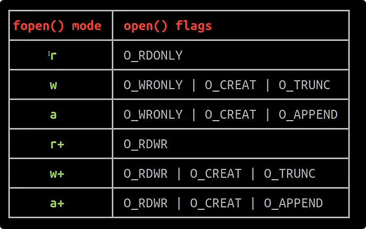

#### 3.3	文件的关闭 close

```
 		#include <unistd.h>
		int close(int fd);
		功能：关闭文件描述符对应的文件
		参数：文件描述符
		返回值：成功返回0，失败返回-1作置位错误码
```

#### 3.4	读写操作: read / write

```c++
		#include <unistd.h>
		
		ssize_t read(int fd, void buf[.count], size_t count);
		功能:从fd文件描述符引用的文件中读取count个字符放入buf对应的容器中
		参数1:已经打开文件对应的文件描述符
		参数2:容器的起始地址
		参数3:要读取的字符个数
		返回值:成功返回读取的字符个数，这个个数可能会小于count的值，失败返回-1并置位错误码
		
		#include <unistd.h>
		
		ssize_t write(int fd, const void buf[.count], size_t count);
		功能: 将buf容器中的count个数据，写入到fd引用的文件中
		参数1：已经打开的文件的文件描述符
		参数2：要写入的数据的起始地址
		参数3：要写入数据的个数
		返回值：成功返回写入的字符个数，这个个数可能小于count,失败返回-1并置位错误码
```

```c++
#include <myhead.h>

int main(int argc, const char *argv[])
{
    // 1、定义文件描述符，对于文件IO而言，句柄就是文件描述符
    int fd = -1;

    // 以只写的形式创建文件，如果文件不存在则创建文件
    // 如果创建文件时没有给权限，则该文件的权限是随机权限
    // 如果创建文件时，给定了文件的权限，则文件最终的权限是给定的 mode & ~umask
    if ((fd = open("./tt.txt", O_WRONLY | O_CREAT, 0644)) == -1)
    {
        perror("open error");
        return -1;
    }

	printf("open success fd = %d\n", fd);    // 3，由于0、1、2已经被使用，所以该数为3

    // 对数据进行读写操作
    char wbuf[128] = "hello world";     // 将上述字符串写入文件中
    write(fd, wbuf, strlen(wbuf));

    // 关闭文件
    close(fd);     // 关闭 fd 引用的文件

    // 再次以只读的形式打开文件，此时参数2中不需要使用 O_CREAT，那么第三个参数也不需要了
    if ((fd = open("./tt.txt", O_RDONLY)) == -1)
    {
        perror("open error");
        return -1;
    }

    printf("open success fd = %d\n", fd);
    // 3

    // 定义接收数据容器
    char rbuf[128] = "";
    int res = read(fd, rbuf, sizeof(rbuf));
    // 从文件中读取数据放入 rbuf 中

    write(1, rbuf, res);
    // 向1号文件描述符中写入数据，之前读取多少，现在写入多少

    // 关闭文件
    close(fd);

    return 0;
}
```

#### 3.5	关于光标的操作: lseek

```cpp
	#include <unistd.h>

    off_t lseek(int fd, off_t offset, int whence);
	功能：移动光标的位置，并返回光标现在所在的位置
	参数1：文件描述符
	参数2：偏移量
    	>0:表示从指定位置向后偏移n个字节
		<0:表示从指定位置向前偏移n个字节
		=0:在指定位置处不偏移
	参数3:偏移的起始位置
		SEEK_SET:文件起始位置
		SEEK_CUR:文件指针当前位置
		SEEK_END:文件结束位置
    返回值：光标现在所在的位置
        
    粗略记忆:fseek+ftell
```

#### 练习：将一个bmp格式的图片信息读取出来，并将该图片的相关内容（颜色）进行更改

如何将windows下的文件，赋值到linux系统的Centos下

```
1、在windows下调出cmd窗口
2、输入指令：
	scp 要拷贝的文件路径 1inux下的用户名@ip地址:linux下存放的地址路径
	eg:scp C:\Users\Admin\Desktop\0101.bmp xq@192.168.16.129:/home/xq/day1/IO/day2
```

```cpp
#include <myhead.h>
using namespace std;
int main(int argc, const char *argv[])
{
    // 以读写的形式大开文件
    int fd = -1;
    if ((fd = open("./0101.bmp", O_RDWR)) == -1)
    {
        perror("open error");
        return -1;
    }
    // 1,822,720
    //  获取文件的大小
    printf("文件的大小为:%ld\n", lseek(fd, 0, SEEK_END));

    // 定义变量储存文件大小
    int pic_size = 0;
    lseek(fd, 2, SEEK_SET); // 将文件从起始位置向后偏移两个字节,跳过文件类型
    read(fd, &pic_size, 4); // 将文件头的3-6字节的内容读取出来
    printf("pic_size = %d\n", pic_size);
    // 将文件光标向后偏移54字节，跳过文件头和信息头
    lseek(fd, 54, SEEK_SET);
    // 定义一像素的颜色：颜色规律是蓝绿红
    unsigned char color[3] = {0, 255, 0};
    // 定义一个绿色
    for (int i = 0; i < 100; i++)
    {
        // 以像素为单位遍历行数，遍历前100行
        for (int j = 0; j < 658; j++)
        {
            // 遍历所有列数
            // 此时的（i，j）定位的就是一个像素点，是一个三字节为单位的颜色点
            write(fd, color, sizeof(color));
        }
    }

    // 关闭文件
    close(fd);
    return 0;
}
```

#### 使用文件IO来完成两个文件的拷贝,可以完成两个图像的拷贝工作

## 三	多进程编程

#进程#多进程

### 一、多进程理论基础

#### 1.1	目的

1>	实现多任务并发执行的一种途径

2>	可以实现数据在多个进程之间进行通信，共同处理整个程序的相关数据，提供工作效率

#### 1.2 	多进程相关概念

1>	进程是程序的一次执行过程,有一定的生命周期,包含了创建太,就绪态,执行态,挂起态,死亡态==

2>	进程是计算机资源分配的基本单位,系统会给每个进程分配0--4G的虚拟内存,其中0--3G是用户空间,3--4G是虚拟空间

其中多个进程中0--3G的用户空间是相互独立的,但是,3--4的虚拟空间是相互共享的

用户空间细分为:栈区,堆区,静态区

3>	进程的调度机制: 时间片轮询上下文切换机制

4>	并发和并行的区别

​		并发：针对于单核CPU系统在处理多个任务时,使用相关的调度机制,实现多个任务进行细化时间片轮询时,在宏观上感觉是多个任务同时执行的操作,同一时刻,只有一个任务在被CPU处理

​		并行：是针对于多核CPU而言，处理多个任务时，同一时间，每个CPU处理的任务之间是并行的，实现的是真正意义上多个任务同时执行的

#### 1.3	进程的内存管理

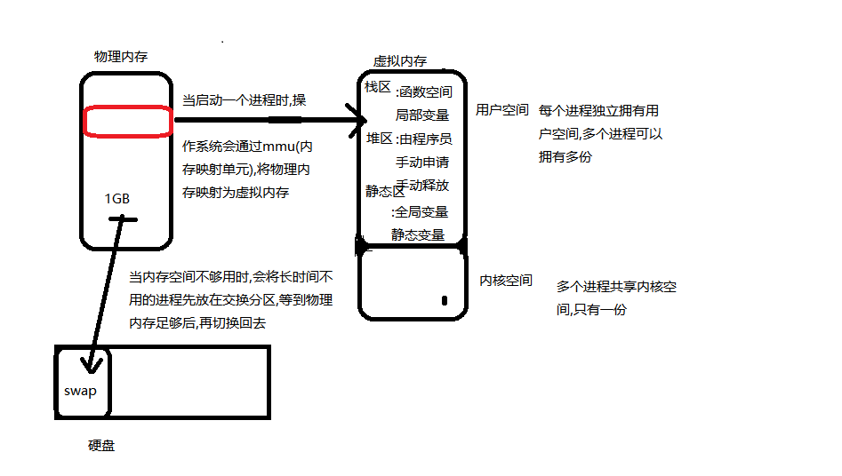

1>	#物理内存	:内存条上(硬件上)真正存在的内存

2>	#虚拟内存	:程序运行后,通过内存映射单元,将物理内存映射出4G的虚拟内存,供进程使用

#### 1.4   进程与程序的区别

进程：是动态的，进程是程序的一次执行过程，是有生命周期的，进程会被分配0-3G的用户空间，进程是在内存上存着的

程序：是静态的，没有所谓的生命周期，程序是存储在磁盘设备上的**二进制文件**

#### 1.5	进程的种类

进程一共有三种:交互进程,批处理进程,守护进程

1>	交互进程:它是由shell控制,可以直接和用户进行交互的,例如文本编辑器

2>	批处理进程:内部维护了一个队列,被放入的队列的进程,会被统一处理,例如g++编译器中一步到位的编译

3>	守护进程脱离了终端而存在，随着系统的启动而运行，随着系统的退出而停止。例如：操作系统的服务进程


#### 1.6	进程PID的概念

#PID #PPID

1>	PID(process ID)	:进程号,进程号是一个大于等于0的整数值,是进程的唯一标识,不可能重复.

2>	PPID(Parent Process ID);父进程号,系统中允许的每个进程,都是拷贝父进程资源得到的

3>	在Linux系统中的	/proc	目录下的数字命名的目录其实都是一个进程


#### 1.7	特殊的进程

1>	0号进程  (idel)	:	它是由Linux操作系统启动后运行的第一个进程,也叫空闲进程,当没有其他进程运行时,会运行该进程.它也是1号进程和2号进程的父进程

2>	1号进程  (init)	:	

3>	2号进程  (kthreadd)	:	也叫调度进程,这个进程也是由0号进程创建出来的,主要完成任务调度问题

4>	孤儿进程	:	当前进程还正在运行,其父进程已经退出了.

> 说明	:	每个进程退出后,其分配的系统资源应该由其父进程进行回收,否则会造成资源的浪费

5>	僵尸进程	:	当前进程已经退出了,但是其父进程没有为其回收资源

#### 1.8	有关进程操作的指令

#进程指令 #进程操作指令 #进程相关属性

1>	**ps指令**	:	能够查看当前运行的进程相关属性

 #进程关系指令

​		ps -ef	:	能够表示进程之间的关系(进程关系)

```
ps -ef
```

```
UID          PID    PPID  C STIME TTY          TIME CMD
root           1       0  1 18:42 ?        00:00:00 /usr/lib/systemd/systemd --switched-root --system --deserialize 
root           2       0  0 18:42 ?        00:00:00 [kthreadd]
root           3       2  0 18:42 ?        00:00:00 [pool_workqueue_]
root           4       2  0 18:42 ?        00:00:00 [kworker/R-rcu_gp]
root           5       2  0 18:42 ?        00:00:00 [kworker/R-sync_wq]
root           6       2  0 18:42 ?        00:00:00 [kworker/R-slub_flushwq]
root           7       2  0 18:42 ?        00:00:00 [kworker/R-netns]
root           8       2  0 18:42 ?        00:00:00 [kworker/0:0-cgroup_destroy]
root           9       2  0 18:42 ?        00:00:00 [kworker/0:0H-events_highpri]
root          10       2  0 18:42 ?        00:00:00 [kworker/u512:0-events_unbound]
root          11       2  0 18:42 ?        00:00:00 [kworker/R-mm_percpu_wq]
root          12       2  1 18:42 ?        00:00:00 [kworker/u512:1-events_unbound]
root          13       2  0 18:42 ?        00:00:00 [rcu_tasks_kthre]
root          14       2  0 18:42 ?        00:00:00 [rcu_tasks_rude_]
root          15       2  0 18:42 ?        00:00:00 [rcu_tasks_trace]
UID	:	用户ID号
PID	:	进程号
PPID :	父进程号
C	:	用处不大
STIME	:	开始运行的时间(日期)
TIME	:	运行的时间
TTY	:	如果是问号表示这个进程不依赖终端而存在

```

px -ajx	:	能够显示当前进程的状态(进程状态,进程组)

#进程状态指令

```
px -ajx
```

```
 PPID     PID    PGID     SID TTY        TPGID STAT   UID   TIME COMMAND
      0       1       1       1 ?             -1 Ss       0   0:00 /usr/lib/systemd/systemd --switched-root --system
      0       2       0       0 ?             -1 S        0   0:00 [kthreadd]
      2       3       0       0 ?             -1 S        0   0:00 [pool_workqueue_]
      2       4       0       0 ?             -1 I<       0   0:00 [kworker/R-rcu_gp]
      2       5       0       0 ?             -1 I<       0   0:00 [kworker/R-sync_wq]
      2       6       0       0 ?             -1 I<       0   0:00 [kworker/R-slub_flushwq]
      2       7       0       0 ?             -1 I<       0   0:00 [kworker/R-netns]

PGID	:	进程组ID
SID	:	会话组ID
STAT	:	进程的状态
```

ps -aux	:	查看当前进程对CPU和内存的占有率

#进程CPU占有率指令

```
ps -aux
```

```
USER         PID %CPU %MEM    VSZ   RSS TTY      STAT START   TIME COMMAND
root           1  0.0  1.0 174848  7776 ?        Ss   18:42   0:01 /usr/lib/systemd/systemd --switched-root --system --deserialize 31 rhgb
root           2  0.0  0.0      0     0 ?        S    18:42   0:00 [kthreadd]
root           3  0.0  0.0      0     0 ?        S    18:42   0:00 [pool_workqueue_]
root           4  0.0  0.0      0     0 ?        I<   18:42   0:00 [kworker/R-rcu_gp]
root           5  0.0  0.0      0     0 ?        I<   18:42   0:00 [kworker/R-sync_wq]
root           6  0.0  0.0      0     0 ?        I<   18:42   0:00 [kworker/R-slub_flushwq]
root           7  0.0  0.0      0     0 ?        I<   18:42   0:00 [kworker/R-netns]
root           9  0.0  0.0      0     0 ?        I<   18:42   0:00 [kworker/0:0H-events_highpri]
root          11  0.0  0.0      0     0 ?        I<   18:42   0:00 [kworker/R-mm_percpu_wq]
root          13  0.0  0.0      0     0 ?        I    18:42   0:00 [rcu_tasks_kthre]
root          14  0.0  0.0      0     0 ?        I    18:42   0:00 [rcu_tasks_rude_]
root          15  0.0  0.0      0     0 ?        I    18:42   0:00 [rcu_tasks_trace]
%CPU	:	CPU占有率
%MEN	:	内存占有率

```

2>	top	:	动态查看进程的运行属性

3秒一更新

```
xq          2849  0.0  0.9 235600  6916 pts/1    R+   19:08   0:00 ps -aux
[xq@localhost ~]$ top
top - 19:13:40 up 31 min,  1 user,  load average: 0.06, 0.38, 0.23
Tasks: 161 total,   1 running, 160 sleeping,   0 stopped,   0 zombie
%Cpu(s):  0.3 us,  0.3 sy,  0.0 ni, 99.0 id,  0.0 wa,  0.3 hi,  0.0 si,  0.0 st
MiB Mem :    732.2 total,    363.3 free,    329.5 used,    153.5 buff/cache
MiB Swap:   2108.0 total,   1912.2 free,    195.8 used.    402.7 avail Mem 

    PID USER      PR  NI    VIRT    RES    SHR S  %CPU  %MEM     TIME+ COMMAND                                                                                 
    783 root      20   0       0      0      0 I   0.3   0.0   0:00.09 kworker/u512:4-events_unbound                                                           
   2799 root      20   0       0      0      0 I   0.3   0.0   0:00.71 kworker/0:2-events                                                                      
      1 root      20   0  174848   8236   5312 S   0.0   1.1   0:01.09 systemd                                                                                 
      2 root      20   0       0      0      0 S   0.0   0.0   0:00.00 kthreadd                                                                                
      3 root      20   0       0      0      0 S   0.0   0.0   0:00.00 pool_workqueue_                                                                         
      4 root       0 -20       0      0      0 I   0.0   0.0   0:00.00 kworker/R-rcu_gp                                                                        
      5 root       0 -20       0      0      0 I   0.0   0.0   0:00.00 kworker/R-sync_wq                                                                       
      6 root       0 -20       0      0      0 I   0.0   0.0   0:00.00 kworker/R-slub_flushwq                                                                  
      7 root       0 -20       0      0      0 I   0.0   0.0   0:00.00 kworker/R-netns                                                                         
      9 root       0 -20       0      0      0 I   0.0   0.0   0:00.00 kworker/0:0H-events_highpri                                                             
     11 root       0 -20       0      0      0 I   0.0   0.0   0:00.00 kworker/R-mm_percpu_wq                                                                  
     13 root      20   0       0      0      0 I   0.0   0.0   0:00.00 rcu_tasks_kthre            
```

3>	kill	:	发送信号的指令

#发送信号的指令

​		使用方式: kill -信号号 进程号

​		可以通过指令:	 kill -l	查看能发送的信号有哪些

```
1) SIGHUP       2) SIGINT       3) SIGQUIT      4) SIGILL       5) SIGTRAP
 6) SIGABRT      7) SIGBUS       8) SIGFPE       9) SIGKILL     10) SIGUSR1
11) SIGSEGV     12) SIGUSR2     13) SIGPIPE     14) SIGALRM     15) SIGTERM
16) SIGSTKFLT   17) SIGCHLD     18) SIGCONT     19) SIGSTOP     20) SIGTSTP
21) SIGTTIN     22) SIGTTOU     23) SIGURG      24) SIGXCPU     25) SIGXFSZ
26) SIGVTALRM   27) SIGPROF     28) SIGWINCH    29) SIGIO       30) SIGPWR
31) SIGSYS      34) SIGRTMIN    35) SIGRTMIN+1  36) SIGRTMIN+2  37) SIGRTMIN+3
38) SIGRTMIN+4  39) SIGRTMIN+5  40) SIGRTMIN+6  41) SIGRTMIN+7  42) SIGRTMIN+8
43) SIGRTMIN+9  44) SIGRTMIN+10 45) SIGRTMIN+11 46) SIGRTMIN+12 47) SIGRTMIN+13
48) SIGRTMIN+14 49) SIGRTMIN+15 50) SIGRTMAX-14 51) SIGRTMAX-13 52) SIGRTMAX-12
53) SIGRTMAX-11 54) SIGRTMAX-10 55) SIGRTMAX-9  56) SIGRTMAX-8  57) SIGRTMAX-7
58) SIGRTMAX-6  59) SIGRTMAX-5  60) SIGRTMAX-4  61) SIGRTMAX-3  62) SIGRTMAX-2
63) SIGRTMAX-1  64) SIGRTMAX

1.一共可以发送62个信号,前32个是稳定信号,后面是不稳定信号
2.常用的信号
SIGHUP:	当进程所在的终端被关闭后,终端会给运行在当前终端的每个进程放送该信号,默认结束进程
SIGINT：中断信号，当用户键入Ctrl+c时发射出来
SIGQUIT：退出信号，当用户键入ctrl+/是发送，退出进程
SIGKILL：杀死指定的进程
SIGSEGV：当指针出现越界访问时，会发射，表示段错误
SIGPIPE：当管道破裂时会发送该信号
SIGALRM：当定时器超时后，会发送该信号
SIGSTOP：暂停进程，当用户键入ctrl+z时发射
SIGTSTP：也是暂停进程
SIGTSTP、SIGUSR2：留给用户自定义的信号，没有默认操作
3、有两个特殊信号：SIGKILL和SIGSTOP，这两个信号既不能被捕获，也不能被忽略
```

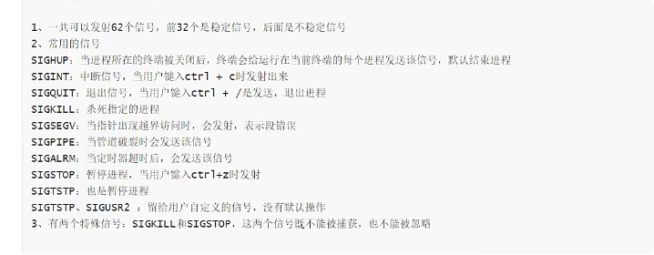


4>	pidof	:	 查看进程的进程号

使用方式: pidof 进程名

#### 1.9	进程状态的切换

1>	可以通过man ps进行查看进程的状态

```
进程的主组状态:	
				D    uninterruptible sleep (usually IO)				不可中断的休眠态,通常是IO操作
                I    Idle kernel thread
                R    running or runnable (on run queue)				运行态
                S    interruptible sleep (waiting for an event to complete)		可中断的休眠态
                T    stopped by job control signal					停止态
                t    stopped by debugger during the tracing			调试时的停止态
                W    paging (not valid since the 2.6.xx kernel)		已经弃用的状态
                X    dead (should never be seen)					死亡态
                Z    defunct ("zombie") process, terminated but not reaped by its parent	僵尸态

附加态:
			   <    high-priority (not nice to other users)			高优先级进程
               N    low-priority (nice to other users)				低优先级进程
               L    has pages locked into memory (for real-time and custom IO)	锁在内存中的进程
               s    is a session leader								会话组组长
               l    is multi-threaded (using CLONE_THREAD, like NPTL pthreads do)	包含多线程的进程
               +    is in the foreground process group				前台运行的进程
```


2>	状态切换实例

```
1、如果有停止的进程，可以在终端输入指令：jobs -l 查看停止进程的作业号
2、通过使用指令：bg 作业号 			 	实现将停止的进程进入后台运行状态，如果只有一个停止的进程，输入bg不加作业号也可以
3、对后台运行的进程，输入fg 作业号 	  	  实现将后台运行的进程切换到前台运行
4、直接将可执行程序后台运行：./可执行程序 &
```

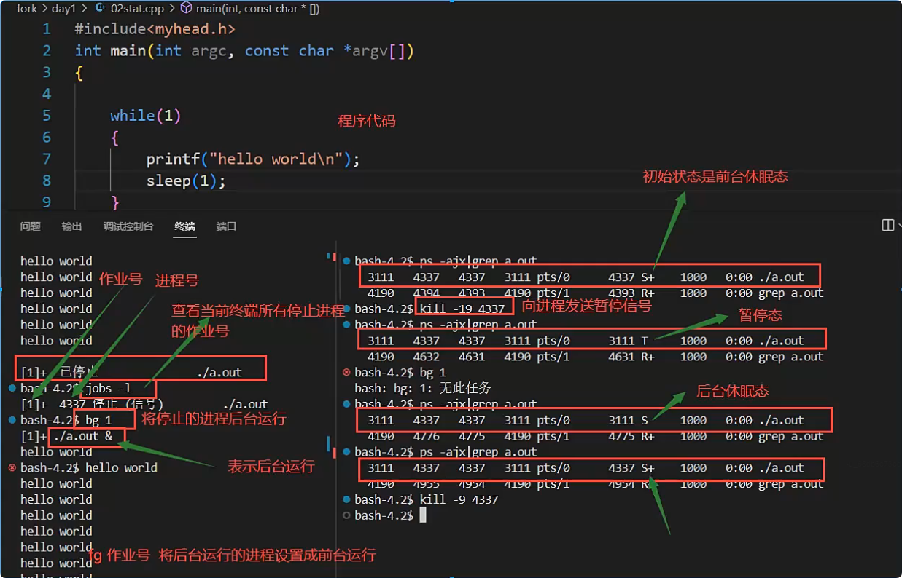3>	进程主要状态的转换（五态图）

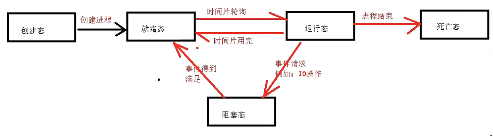

### 二、多进程实现

------

进程的创建过程，是子进程通过拷贝父进程得到的，新进程的创建直接拷贝父进程的资源，只需改变很少部分的数据即可，保留了父
进程的大部分的数据信息（遗传基因），所以这个拷贝过程，系统通过一个函数fork来自动完成

#### 2.1	进程的创建:	fork

```
	#include <unistd.h>
	
	pid_t fork(void)
	功能：通过拷贝父进程得到一个子进程
	参数：无
	返回值：成功在父进程中得到子进程的pid，在子进程中的到0，失败返回-1并置位错误码
```

1>	不关注返回值的案例

```cpp
#include<myhead.h>
int main(int argc, const char *argv[])
{
	printf("ni hao xingqiu'n");
	
	fork();			//创建一个子进程
	
	printf("hello worldn");
	
	while(1);		//防止进程结束
	
	return 0;
}
```


2>	多个fork创建进程

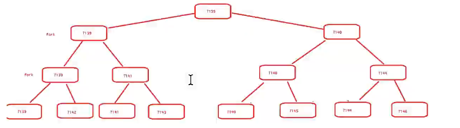


3>返回值案列

```
#include <myhead.h>
using namespace std;
int main(int argc, const char *argv[])
{
    pid_t pid = -1;

    pid = fork(); // 创建一个子进程，父进程会将返回值赋值给父进程中的pid变量
                  // 子进程会将返回值赋值给子进程中的pid变量

    printf("pid=%d\n", pid); // 对于父进程而言会得到大于的数字，对于子进程而言会得到0

    if (pid > 0)
    {
        // 父进程代码

        printf("我是父进1111\n");
    }
    else if (pid == 0)
    {
        // 子进程代码

        printf("我是子进程\n");
        sleep(1);
    }
    else
    {
        perror("fork error");
        return -1;
    }
    while (1)
        ;
    return 0;
}
```


4>父子进程并发执行的案例

```
#include <myhead.h>
using namespace std;
int main(int argc, const char *argv[])
{
    pid_t pid = -1;

    pid = fork(); // 创建一个子进程，父进程会将返回值赋值给父进程中的pid变量
                  // 子进程会将返回值赋值给子进程中的pid变量

    printf("pid=%d\n", pid); // 对于父进程而言会得到大于的数字，对于子进程而言会得到0

    if (pid > 0)
    {
        // 父进程代码
        while (1)
        {
            printf("我是父进1111\n");
            sleep(1);
        }
    }
    else if (pid == 0)
    {
        // 子进程代码
        while (1)
        {
            printf("我是子进程\n");
            sleep(1);
        }
    }
    else
    {
        perror("fork error");
        return -1;
    }

    return 0;
}
```


#### 2.2父子进程号的获取：getpid、getppid

```
		#include <unistd.h>

        pid_t getpid(void);
        功能：获取当前进程的进程号
		参数：无
		返回值：当前进程的进程号
        pid_t getppid(void);
        功能：获取当前进程的父进程pid号
		参数：无
		返回值：当前进程的父进程pid
```

```
#include <myhead.h>
using namespace std;
int main(int argc, const char *argv[])
{
    pid_t pid = -1;
    pid = fork();
    if (pid > 0)
    {
        // 父进程程序代码
        // 输出当前进程号、子进程号、父进程号
        printf("self pid=%d, child pid = %d, parent pid = %d\n", getpid(), pid, getppid());
    }
    else if (pid == 0)
    {
        // 子进程程序代码
        // 输出当前进程号、父进程号
        printf("self pid = %d,parent pid = %d\n", getpid(), getppid());
    }
    else
    {
        perror("fork error");
        return -1;
    }
    while (1)
        ;
    return 0;
}

```


#### 2.3	进程退出：exit/_exit

上述两个函数都可以完成进程的退出，区别是在退出进程时，是否刷新标准IO的缓冲区

exit属于库函数，使用该函数退出进程时，会刷新标准IO的缓冲区后退出
		_exit属于系统调用（内核提供的函数），使用该函数退出进程时，不会刷新标准IO的缓冲区

```
		#include <stdlib.h>
		
        void exit(int status);
		功能：退出当前进程，并刷新当前进程打开的标准IO的缓冲区
		参数：进程退出时的状态，会将改制与0377进行位与运算后，返回给回收资源的进程
		返回值：无
		
		#include <unistd.h>
		
		void _exit(int status);
		功能：退出当前进程，不刷新当前进程打开的标准IO的缓冲区
		参数：进程退出时的状态，会将改制与0377进行位与运算后，返回给回收资源的进程
		返回值：无
```


#### 2.4进程资源回收：wait、waitpid

有两个函数可以完成对进程资源的回收
		wait:	是阻塞回收任意一个子进程的资源函数
		waitpid：可以阻塞，也可以非阻塞完成对指定的进程号进程资源回收

```
 #include <sys/wait.h>

       pid_t wait(int *_Nullable wstatus);
	    功能：阻塞回收子进程的资源
	    参数：接收子进程退出时的状态，获取子进程退出时的状态与0377进行位与后的结果，如果不愿意接收，可以填NUL
		返回值：成功返回回收资源的那个进程的pid号，失败返回-1并置位错误码
		
       pid_t waitpid(pid_t pid, int *_Nullable wstatus, int options);
		功能：可以阻塞也可以非阻塞回收指定进程的资源
参数1：进程号
		>0：表示回收指定的进程，进程号位pid（常用）
		=0：表示回收当前进程所在进程组中的任意一个子进程
		=-1：表示回收任意一个子进程（常用）
		<-1:表示回收指定进程组中的任意一个子进程，进程组id为给定的pid的绝对值      
参数2：接收子进程退出时的状态，获取子进程退出时的状态与0377进行位与后的结果，如果不愿意接收，可以填NULL
参数3：是否阻塞
		0：表示阻塞等待			：waitpid(-1，&status，0);等价于wait(&status)
		WNOHANG：表示非阻塞
返回值：
		>0：返回的是成功回收的子进程pid号
		=0：表示本次没有回收到子进程
		=-1：出错并置位错误码
```

```c++
#include <myhead.h>
using namespace std;
int main(int argc, const char *argv[])
{
    pid_t pid = -1;
    pid = fork();
    if (pid > 0)
    {
        // 父进程程序代码
        // 输出当前进程号、子进程号、父进程号
        printf("self pid=%d, child pid = %d, parent pid = %d\n", getpid(), pid, getppid());
        sleep(8);
        //wait(NULL);		//回收子进程资源,只有回收了子进程资源后,父进程才继续先后执行
        waitpid(-1,NULL,WNOHANG);
        printf("子进程资源已回收\n");
    }
    else if (pid == 0)
    {
        // 子进程程序代码
        // 输出当前进程号、父进程号
        printf("self pid = %d,parent pid = %d\n", getpid(), getppid());
        sleep(3);
        wait(NULL);


        exit (EXIT_SUCCESS);			//刷新缓冲区并退出进程
		//_exit(EXIT_SUCCESS)；		//不刷新缓冲区退出进程
    else
    {
        perror("fork error");
        return -1;
    }
    while (1);			
    return 0;
}

```

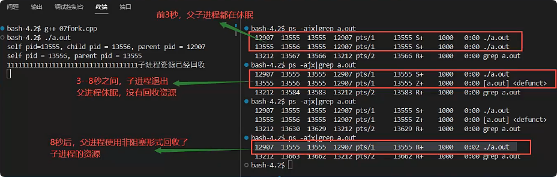

#### 练习：使用多进程完成两个文件的拷贝工作，父进程拷贝前一半内容，子进程拷贝后一半内容，父进程要回收子进程的资源

```c++
#include <myhead.h>
#include <sys/wait.h>
#include <cstdlib>
using namespace std;
// 定义求文件大小的函数
int get_file_size(const char *srcfile, const char *destfile)
{
    // 以只读的形式打开源文件,以创建写的形式打开目标文件
    int srcfd, destfd; // 记录源文件和目标文件的文件描述符
    if ((srcfd = open(srcfile, O_RDONLY)) == -1)
    {
        perror("open srcfile errpr");
        return -1;
    }
    if ((destfd = open(destfile, O_WRONLY | O_CREAT | O_TRUNC)) == -1)
    {
        perror("open destfile error");
        return -1;
    }

    // 求原文件的大小
    int len = lseek(srcfd, 0, SEEK_END);

    // 关闭文件
    close(srcfd);
    close(destfd);

    return len; // 将源文件大小返回
}

// 定义拷贝函数
int copy_file(const char *srcfile, const char *destfile, int start, int len)
{
    // 以只读形式打开源文件,以只写的形式打开源文件
    int srcfd, destfd; // 记录源文件和目标文件的文件描述符
    if ((srcfd = open(srcfile, O_RDONLY)) == -1)
    {
        perror("open srcfile errpr");
        return -1;
    }
    if ((destfd = open(destfile, O_WRONLY | O_CREAT)) == -1)
    {
        perror("open destfile error");
        return -1;
    }

    // 将两个文件的光标位置统一
    lseek(srcfd, start, SEEK_SET);
    lseek(destfd, start, SEEK_SET);

    // 开始拷贝
    char buf[128] = ""; // 中间量
    int sum = 0;
    while (1)
    {
        int res = read(srcfd, buf, sizeof(buf)); // 从源文件中读取数据
        sum += res;
        if (res == 0 || sum >= res)
        {
            write(destfd, buf, res - (sum - len));
            break; // 结束
        }
        write(destfd, buf, res); // 从源文件读多少，写入目标文件多少
    }

    // 关闭文件
    close(srcfd);
    close(destfd);
    return sum;
}

/************************** */
int main(int argc, const char *argv[])
{
    if (argc != 3)
    {
        printf("input file error\n");
        printf("usage:./a.out srcfile destfile\n");
        return -1;
    }
    // 获取目标文件的长度,并且创建目标文件
    int len = get_file_size(argv[1], argv[2]);

    pid_t pid = fork();
    if (pid > 0)
    {
        copy_file(argv[1], argv[2], 0, len / 2); // 从开头位置拷贝,拷贝len/2内容

        // 回收子进程资源
        wait(NULL);
    }
    else if (pid == 0)
    {
        copy_file(argv[1], argv[2], len / 2, len - len / 2);

        exit(EXIT_SUCCESS);
    }
    else
    {
        perror("error");
    }

    return 0;
}

```


#### 2.5 父进程创建奇数个进程并为其收尸

```cpp
#include <myhead.h>
using namespace std;
int main(int argc, const char *argv[])
{
    pid_t pid = fork(); // 创建大儿子
    if (pid > 0)
    {
        // 父进程
        pid_t pid_2 = fork(); // 例建二儿子
        if (pid_2 > 0)
        {
            // 父进程
            printf("我是父进程\n");
            // 回收两个子进程的资源
            wait(NULL);
            wait(NULL);
        }
        else if (pid_2 == 0)
        {
            sleep(3);
            // 二儿子进程内容
            printf("我是进程2\n");
            exit(EXIT_SUCCESS);
        }
    }
    else if (pid == 0)
    {
        sleep(3)
            // 大儿子进程
            printf("我是进程1\n");
        exit(EXIT_SUCCESS);
    }
    else
    {
        perror("fork error");
        return -1;
    }

    return 0;
}
```

#### 2.6僵尸进程与孤儿进程

1>	孤儿进程:当前进程还正在运行,其父进程已经退出了.

​				说明:	每个进程退出后,其分配的系统资源应该由其父进程进行回收,否则会造成资源的浪费

```CPP
#include <myhead.h>
using namespace std;
int main(int argc, const char *argv[])
{
    pid_t pid = -1;
    pid = fork();
    if (pid > 0)
    {
        // 父进程程序代码
        sleep(5);
        exit(EXIT_SUCCESS); // 父进程退出
    }
    else if (pid == 0)
    {
        // 子进程程序代码
        while (1)
        {
            printf("我是子进程");
            sleep(1);
        }
    }
    else
    {
        perror("fork error");
        return -1;
    }
    while (1)
        ;
    return 0;
}


```

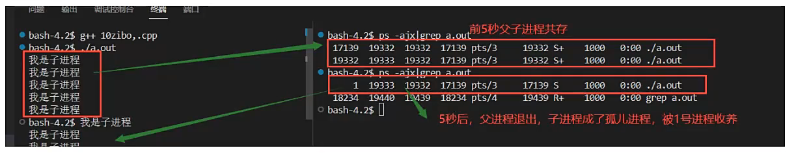

2>	僵尸进程:当前进程已经退出了,但是其父进程没有为其回收资源 

```CPP
#include <myhead.h>
using namespace std;
int main(int argc, const char *argv[])
{
    pid_t pid = -1;
    pid = fork();
    if (pid > 0)
    {
        // 父进程程序代码
        while (1)
        {
            printf("我是子进程");
            sleep(1);
        }
    }
    else if (pid == 0)
    {
        // 子进程程序代码
        sleep(5);
        exit(EXIT_SUCCESS); // 父进程退出
    }
    else
    {
        perror("fork error");
        return -1;
    }
    while (1)
        ;
    return 0;
}

```

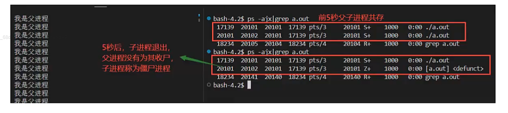


### 	三、 进程间通信IPC

1>由于多个进程的用户空间是相互独立的，其栈区、堆区、静态区的数据都是彼此私有的，所以不可能通过用户空间中的区域完成多个进程之间数据的通信

2>可以使用外部文件来完成多个进程之间数据的传递,一个进程向文件中写入数据，另一个进程从文件中读取数据。该方法必须写进程先完成,然后再执行读进程,要保证进程执行的同步性

3>我们可以利用内核空间来完成对数据的通信工作,本质上,在内核空间创建一个特殊的区域,一个进程向该区域中存放数据,另一个进程可以向该区域中读取数据

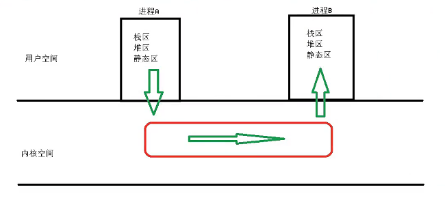

4>引入原因:用户空间中的数据,不能作为多个进程之间数据交换的容器

```
#include <myhead.h>
using namespace std;

int num = 520;

int main(int argc, const char *argv[])
{
    pid_t pid = fork();

    if (pid > 0)
    {
        // 父进程
        num == 1111;
        printf("父进程中:num = %d\n", num);

        wait(NULL);
    }
    else if (pid == 0)
    {
        // 子进程
        sleep(3);
        printf("子进程中:num = %d\n", num);
    }
    else
    {
        perror("fork error");
        return -1;
    }

    return 0;
}
```


#### 3.1	进程间通信的基础概念

1>	IPC:interprocess communication进程间通信

2>	使用内核空间来完成多个进程间相互通信，根据使用的容器或方式不同，分为三类通信机制

3>	进程间通信方式分类

```
1、内核提供的通信方式(传统的通信方式)
	无名管道
	有名管道
	信号
2、system V提供的通信方式
	消息队列
	共亭内存
	信号量（信号灯集）
3.套接字通信：socket网络通信（跨主机通信）
```

#### 3.2	无名管道

1>管道的原理：管道是一种特殊的文件，该文件不用于存储数据，只用于进程间通信。管道分为有名管道和无名管道

```
文件类型:bcd-lsp
b:块设备文件
c：字符设备文件
d：日录文件，文件夹
-：普通文件
l：链接文件
s：套接字文件（网络编程）
p：管道文件
```

2>	在内核空间创建一个管道通信,一个进程可以将数据写入管道,经由管道缓冲到另一个进程中读取

3>	无名管道：顾名思义就是没有名字的管道，会在内存中创建出该管道，不存在于文件系统，随着进程结束而消失

4>	无名管道仅适用于亲缘进程问通信，不适用于非亲缘进程间通信

5>	无名管道的API

```cpp
	#include <unistd.h>

	int pipe(int fildes[2]);
		功能：创建一个无名管道，并返回该管道的两个文件描述符
		参数：是一个整型数组，用于返回打开的管道的两端的文件描述符，fildes[0]表示读端fildes[1]表示写端
		返回值:成功返回0,失败返回-1并置位错误码
```

```cpp
#include <myhead.h>
using namespace std;

int main(int argc, const char *argv[])
{
    // 可以在此创建管道文件，并返回该管道文件的两端,那么父子进程都会拥有该管道两端的文件描述符
    int fildes[2]; // 存放管道文件的两端文件描述符

    if (pipe(fildes) == -1)
    {
        perror("pipe error");
        return -1;
    }
    printf("fildes[0]=%d,fildes[1]=%d\n", fildes[0], fildes[1]);
    pid_t pid = fork();
    // 也不可以在此创建管道文件，因为如果在此创建，那么父进程中和子进程中会分别创建一个无名管道
    if (pid > 0)
    {
        // 父进程
        // 关闭读端
        close(fildes[0]);
        char wbuf[128] = "xshell";
        // 如果在此创建管道，那么只能父进程使用，因为子进程中没有管道文件的读端和写端文件描述符

        // 将上述数据发送的子进程
        write(fildes[1], wbuf, strlen(wbuf));
        // 关闭写端
        close(fildes[1]);
        wait(NULL);
    }
    else if (pid == 0)
    {
        // 子进程
        // 关闭写端
        close(fildes[1]);
        // 通过读端从管道文件中读取数据
        char rbuf[128] = "";
        read(fildes[0], rbuf, sizeof(rbuf));
        // 关闭读端
        close(fildes[0]);
        printf("收到父进程的数据%s\n", rbuf);
        exit(EXIT_SUCCESS);
    }
    else
    {
        perror("fork error");
        return -1;
    }

    return 0;
}

```


6>管道通信特点

```
1.管道可以实现自己给自己发消息
2、对管道中数据的操作是一次性的,当管道中的数据被读取后，就从管道中消失了,再读取时会被阻塞
3、管道文件的大小：64K
4、由于返回的是管道文件的文件描述符，所以对管道的操作只能是文件Io相关函数，但是，不可以使用1seek对光标进行偏移，必须做到先进先出
5.管道的读写特点：
	当读端存在时：写端有多少写多少，直到写满64k后，在write处阻塞
	当读端不存在时：写端再向管道中写入数据时，会发生管道破裂，内核空间会向用户空间发射一个SIGPIPE信号，进程收到该信号后，退出
	自写端存在时：读端有多少读多少,没有数据，会在read处阻塞
	当写端不存在时：读端有多少读多少，没有数据,不会在read处阻塞了
6、管道通信是半双工通信方式
	单工：只能进程A向B发送消息
	半双工：同一时刻只能A向B发消息
	全双工：任意时刻，AB可以互相通信
```

验证自己跟自己通信


#### 3.3	有名管道

1>顾名思义就是有名字的管道文件，会在文件系统中创建一个真实存在的管道文件

2>既可以完成亲缘进程间通信，也可以完成非亲缘进程间通信

3> 有名管道的API

```
#include <sys/types.h>
#include <sys/stat.h>
int mkfifo(const char *pathname, mode_t mode);			//0664
功能：创建一个管道文件，并存在与文件系统中
参数1：管道文件的名称
参数2：管道文件的权限，内容详见open函数的mode参数
返回值：成功返回0，失败返回-1并置位错误码
注意：管道文件被创建后，其他进程就可以进行打开读写操作了，但是，必须要保证当前管道文件的两端都打开后，才能进行读写操作，否则函数会在open处阻塞

```

4>案例

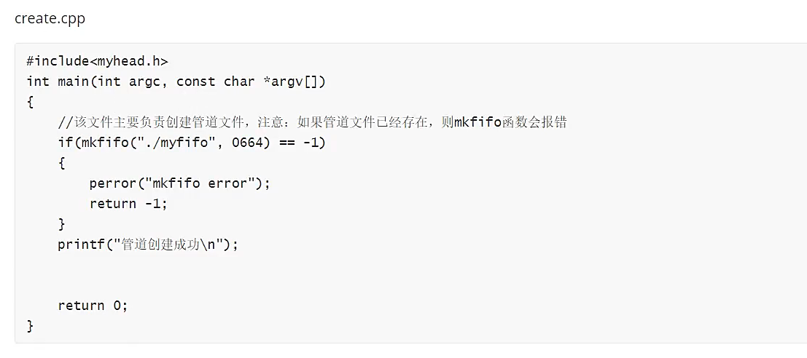


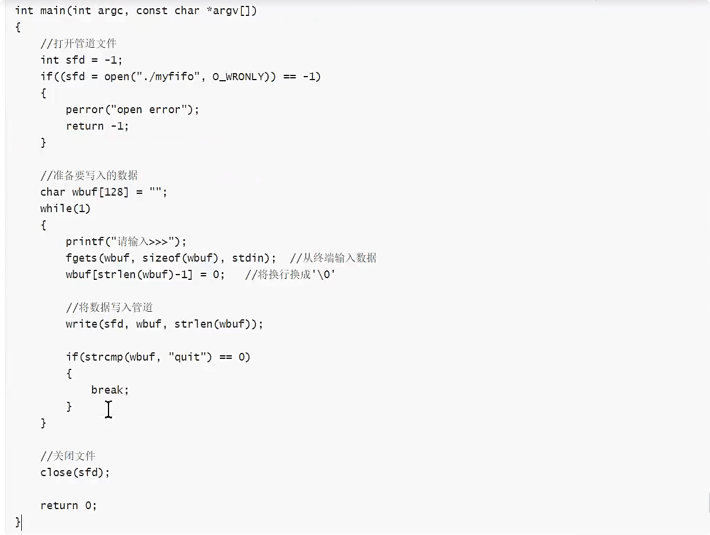

recv.cpp

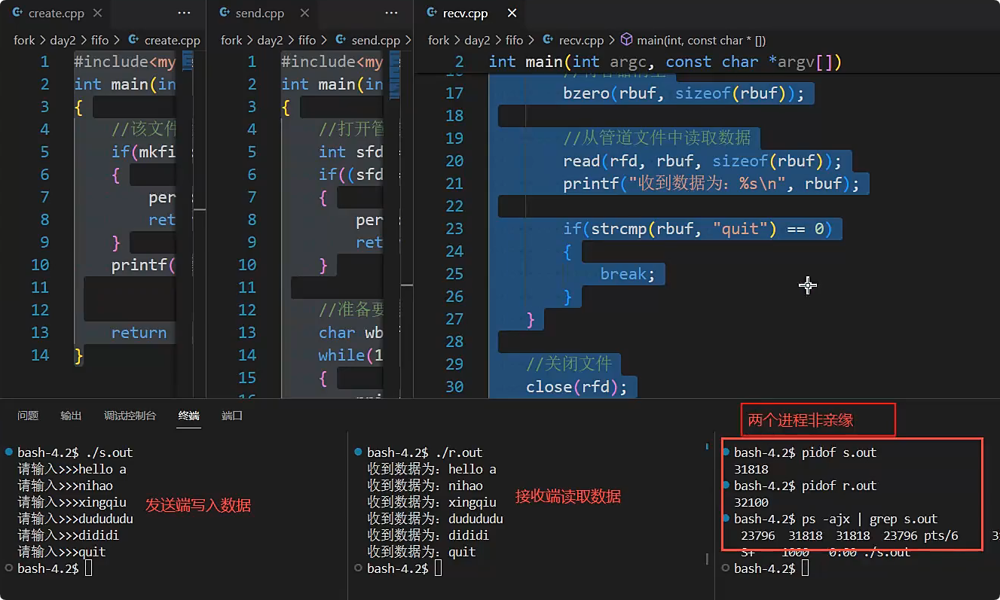

练习：使用有名管道实现，两个进程之间相互通信，提示：可以使用多进程或多线程


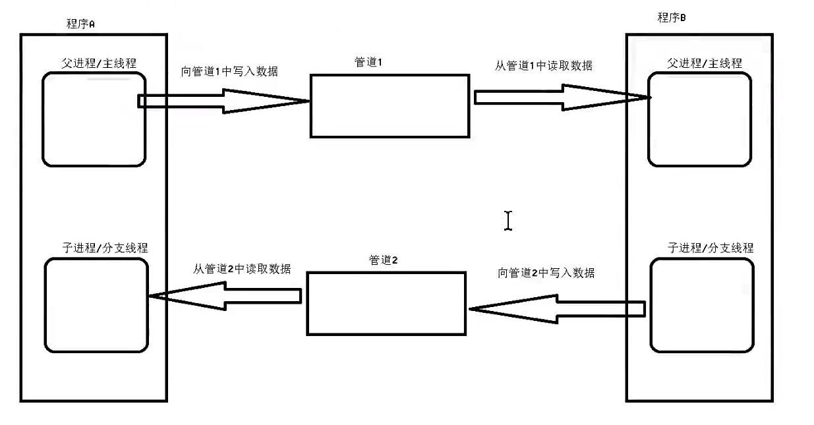

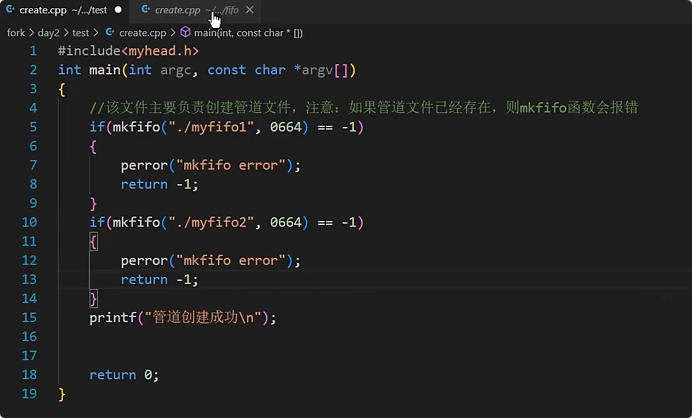


#### 3.4 信号

##### 1>信号相关概念

```
1、信号是软件模拟硬件的中断功能，信号是软件实现的，中断是硬件实现的
中断：停止当前正在执行的事情，去做另一件事情
2、信号是linux内核实现的，没有内核就没有信号的概念
3、用户可以给进程发信号：例如键入ctrl+c
内核可以向进程发送信号：例如SIGPIPE
一个进程可以给另一个进程发送信号，需要通过相关函数来完成
4、信号通信是属于异步通信工作
同步：表示多个任务有先后顺序的执行,例如去银行办理业务
异步：表示多个任务没有先后顺序执行,例如你在敲代码，你妈妈在做饭
```

##### 2>通信原理图

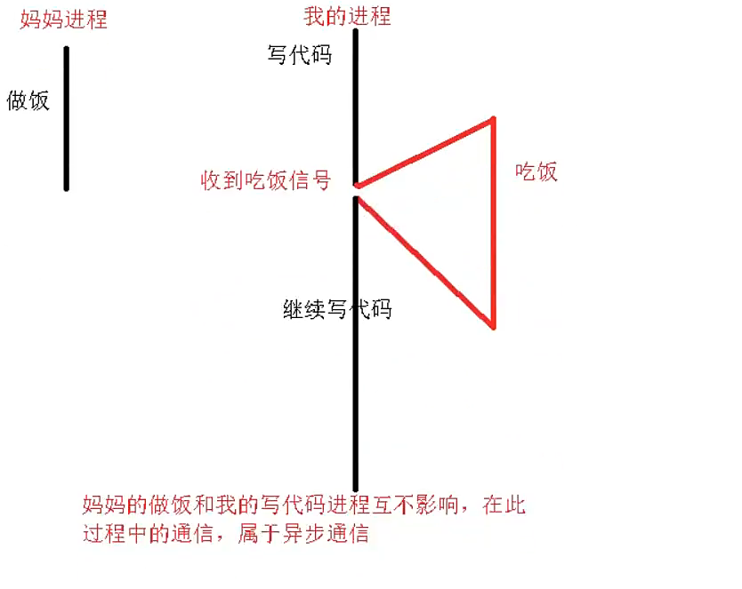


##### 3>信号的种类及功能

```
1) SIGHUP       2) SIGINT       3) SIGQUIT      4) SIGILL       5) SIGTRAP
 6) SIGABRT      7) SIGBUS       8) SIGFPE       9) SIGKILL     10) SIGUSR1
11) SIGSEGV     12) SIGUSR2     13) SIGPIPE     14) SIGALRM     15) SIGTERM
16) SIGSTKFLT   17) SIGCHLD     18) SIGCONT     19) SIGSTOP     20) SIGTSTP
21) SIGTTIN     22) SIGTTOU     23) SIGURG      24) SIGXCPU     25) SIGXFSZ
26) SIGVTALRM   27) SIGPROF     28) SIGWINCH    29) SIGIO       30) SIGPWR
31) SIGSYS      34) SIGRTMIN    35) SIGRTMIN+1  36) SIGRTMIN+2  37) SIGRTMIN+3
38) SIGRTMIN+4  39) SIGRTMIN+5  40) SIGRTMIN+6  41) SIGRTMIN+7  42) SIGRTMIN+8
43) SIGRTMIN+9  44) SIGRTMIN+10 45) SIGRTMIN+11 46) SIGRTMIN+12 47) SIGRTMIN+13
48) SIGRTMIN+14 49) SIGRTMIN+15 50) SIGRTMAX-14 51) SIGRTMAX-13 52) SIGRTMAX-12
53) SIGRTMAX-11 54) SIGRTMAX-10 55) SIGRTMAX-9  56) SIGRTMAX-8  57) SIGRTMAX-7
58) SIGRTMAX-6  59) SIGRTMAX-5  60) SIGRTMAX-4  61) SIGRTMAX-3  62) SIGRTMAX-2
63) SIGRTMAX-1  64) SIGRTMAX

1.一共可以发送62个信号,前32个是稳定信号,后面是不稳定信号
2.常用的信号
SIGHUP:	当进程所在的终端被关闭后,终端会给运行在当前终端的每个进程放送该信号,默认结束进程
SIGINT：中断信号，当用户键入Ctrl+c时发射出来
SIGQUIT：退出信号，当用户键入ctrl+/是发送，退出进程
SIGKILL：杀死指定的进程
SIGSEGV：当指针出现越界访问时，会发射，表示段错误
SIGPIPE：当管道破裂时会发送该信号
SIGALRM：当定时器超时后，会发送该信号
SIGSTOP：暂停进程，当用户键入ctrl+z时发射
SIGTSTP：也是暂停进程
SIGTSTP、SIGUSR2：留给用户自定义的信号，没有默认操作
3、有两个特殊信号：SIGKILL和SIGSTOP，这两个信号既不能被捕获，也不能被忽略
```

##### 4>对应信号的处理方式有三种：捕获、忽略、默认

##### 5>对信号的处理函数:signal

```
#include <signal.h>
typedef void (*sighandler_t)(int);
sighandler_t signal(int signum, sighandler_t handler);
功能：将信号与信号处理方式绑定到一起
参数1：要处理的信号
参数2：处理方式
SIG_IGN:忽略
SIG_DFL：默认，一般信号的默认操作都是杀死进程
typedef void(*sighandler_t)(int):用户自定义的函数
返回值：成功返回处理方式的起始地址，失败返回SIG_ERR并置位错误码

注意：只要程序与信号绑定一次，后续但凡程序收到该信号，对应的处理方式就会立即响应
```

1忽略

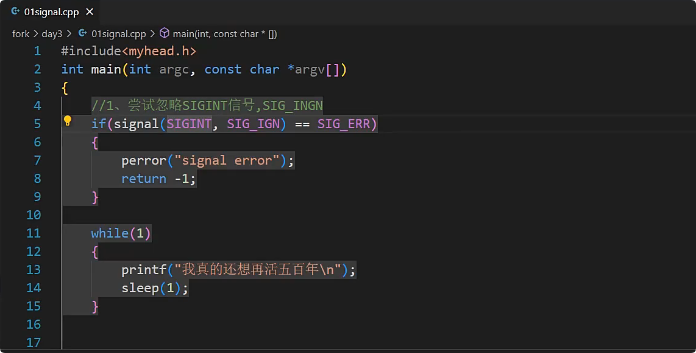

2捕获

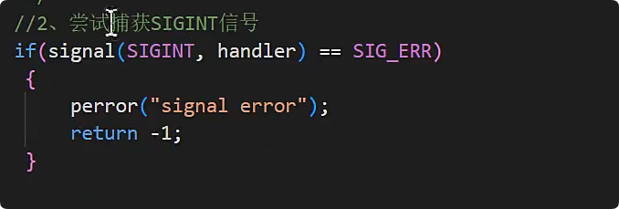

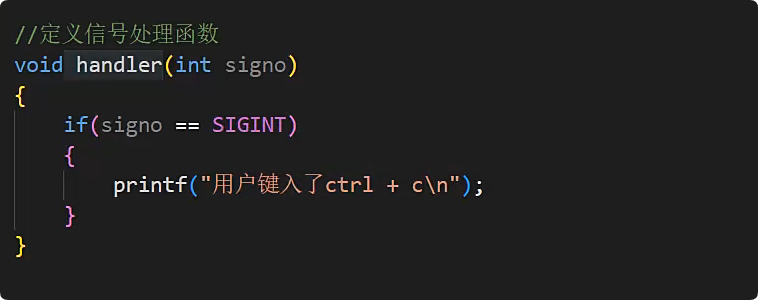

3默认

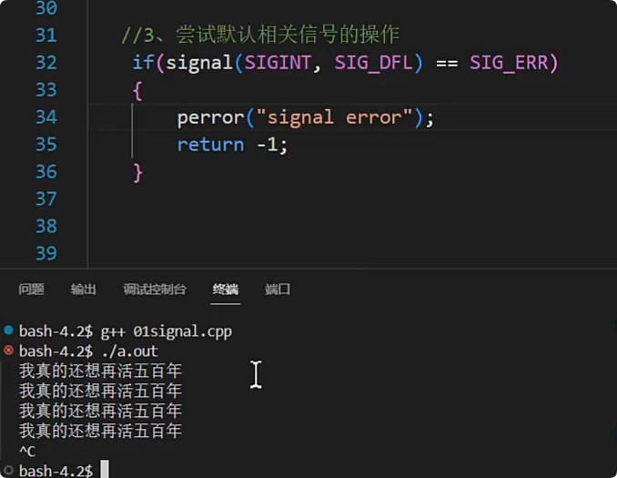


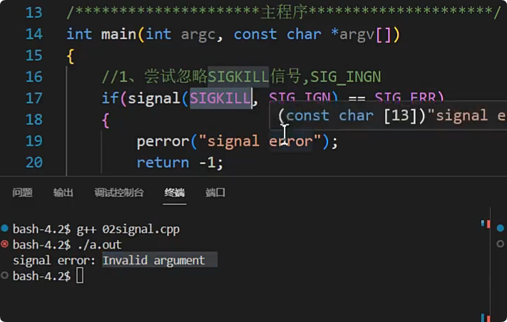

-

##### 6>使用信号的方式完成对僵尸进程的回收

当子进程退出后，会向父进程发送一个SIGCHLD的信号，当父进程收到该信号后，可以将其进行捕获，在信号处理函数中，可以以非阻塞的方式回收僵尸进程

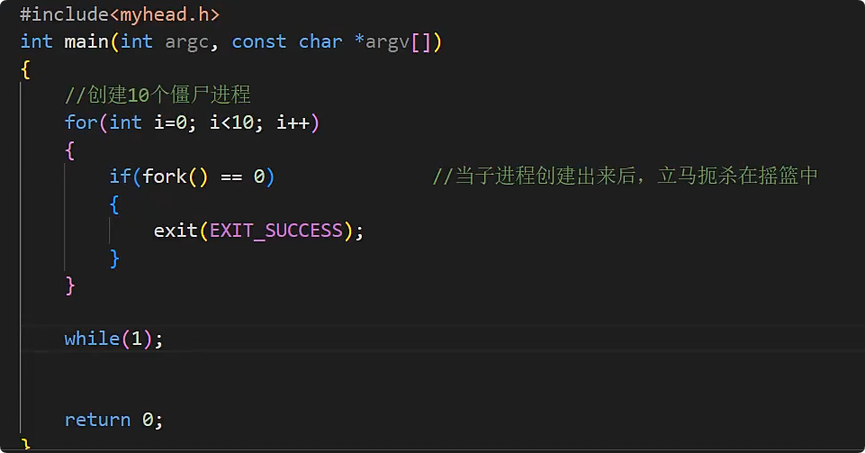

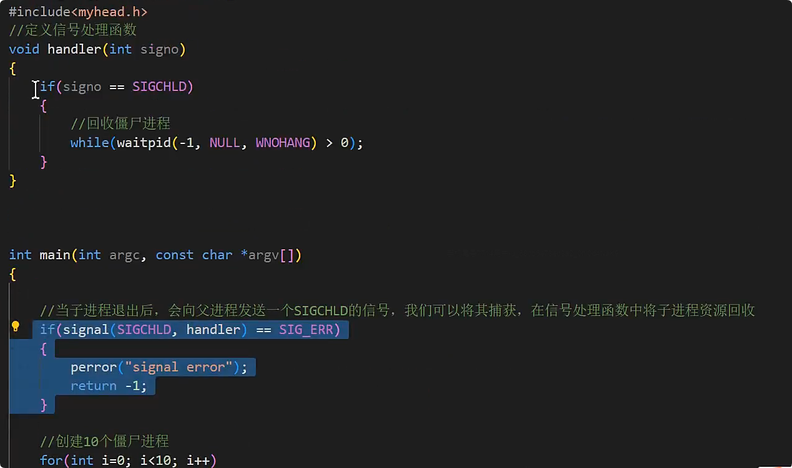

-

##### 7>信号发送函数：kill、raise

```
	#include <signal.h>	

	int kill(pid_t pid,int sig);
功能：向指定进程或进程组发送信号
参数1：进程号或进程组号
0：表示向执行进程发送信号
=0：向当前进程所在的进程组中的所有进程发送信号
=-1：向所有进程发送信号
<-1：向指定进程组发送信号，进程组的ID号为给定pid的绝对值
参数2：要发送的信号
返回值：成功返回0，失败返回-1并置位错误码

#include <signal.h>
int raise(int sig);
功能：向自己发送信号
等价于：kill(getpid()，sig)；
参数：要发送的信号
返回值：成功返回0，失败返回非0数组

```

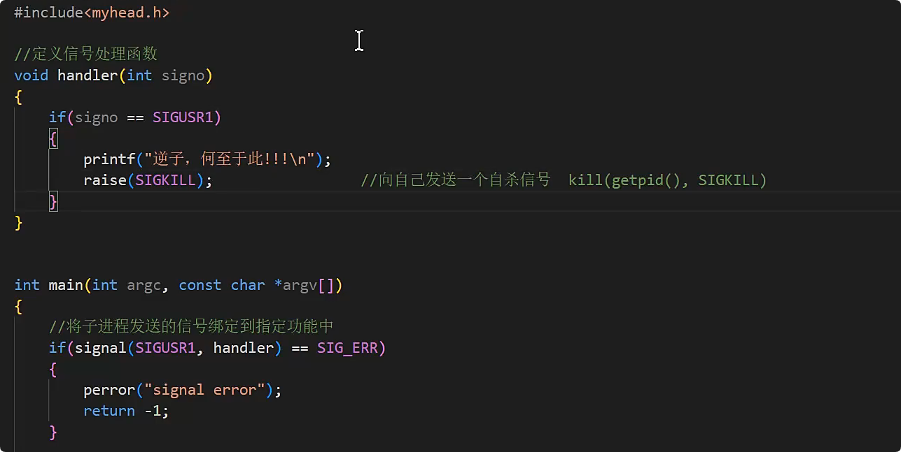

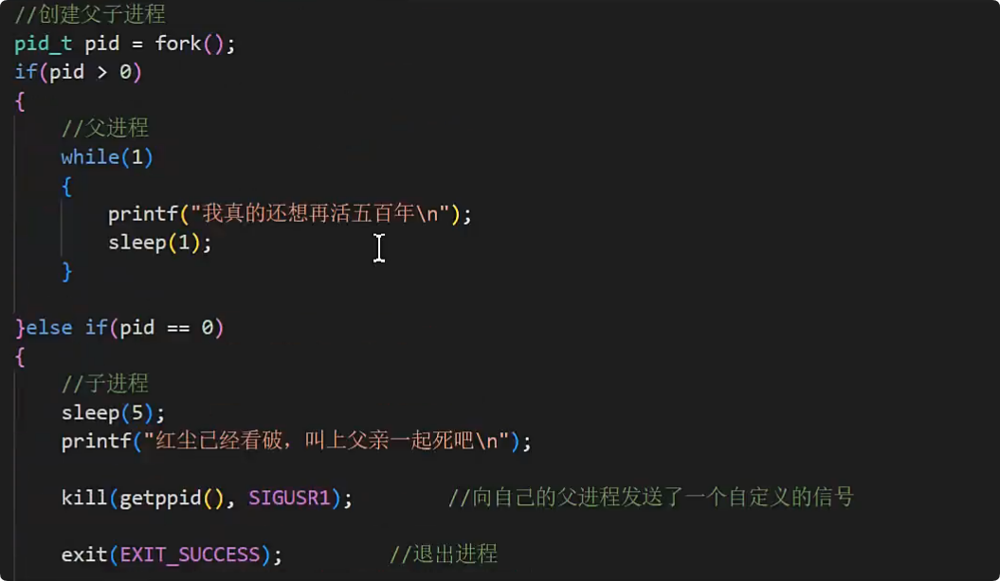


##### 8>总结：信号可以完成多个进程间通知作用，但是，不能进行数据传输功能


#### 3.5	system V提供的进程间通信概述

1>对于内核提供的三种通信方式，对于管道而言，只能实现单向的数据通信，对于信号通信而言，只能完成多进程之间消息的通知，不能起到数据传输的效果。为了解决上述问题，引入的系统V进程间通信

2>systemV提供的进程间通信方式分别是：消息队列、共享内存、信号量（信号灯集）

3>有关systemV进程间通信对象相关的指令

```
ipcs可以查看所有的信息（消息队列、共享内存、信号量）
ipcs -q:可以查看消息队列的信息
ipcs -m:可以查看共享内存的信息
ipcs -s:可以查看信号量的信息
ipcrm -q/m/s ID：可以删除指定ID的IPC对象
```

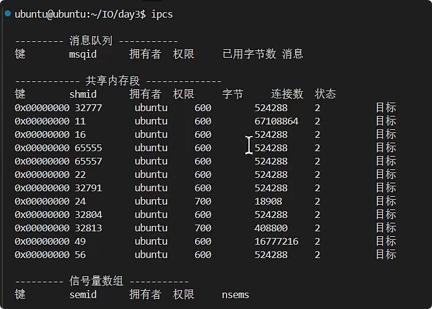


## 四	多线程

### 4.1 C++中多线程

### 4.2 多线程的概念

### 4.3 多线程编程

### 4.4 线程同步互斥机制

## 五	网络编程基础

### 一、网络编程的基本概念

##### 1>	通信协议


**1.1	为什么引入网络编程**

1>	回顾之前学习的进程间通信方式:
		内核提供三种：有名管道、无名管道、信号
		system V提供三种：消息队列、共享内存、信号量集
2>	以上通信方式，仅仅局限于同一主机之间多个进程间通信方式，不能实现跨主机的通信方式
3>	如果想要实现跨主机的通信方式，我们引入的套接字的通信方式，就是该门课程要讲述的内容


##### 1.2网络的发展历史

1>	第一阶段：APRAnet阶段--------冷战的产物
		阿帕网，是Internet的最早雏形，注意，此时的网络**不能实现互联不同类型的计算机和不同类型的操作系统，并且没有纠错功能**
2>	TCP\IP两个协议的阶段

​		协议：在计算机网络中，要做到有条不素的交换数据，需要遵循一些实现约定好的规则，这些规则明确规定了所交换数据的格式以及相关的同步问题。


```
网络体系结构的概念
1>	每一层都有自己独立的分工，单每一层都不可获取
2>通常将功能相近的协议组织在一起放在一层，称为协议栈，所以每一层中共实有多个协议

分层的好处：
1>	各层之间相互独立，每一层不需要知道下一层如何实现，而仅仅只需要知道该层通过层间接口所提供的服务
2>	稳定、灵活性好。当每一层出现变化时，只要层间接口保持不变，则当前层的上层和下次不受影响
3>	易于实现和维护，只要知道哪一层的功能，直接对指定层进行维护即可
4>	促进标准化工作，每一层所提供的服务和技术都有精确的说明
5>	结构上是不可分割的，各层之间都采用的最合适的技术来实现
```

1、OSI（开发系统互联模型）是由ISO（国际标准化组织）提出的理想化模型，一共有七层：物数网传会表应


2、TCP\IP协议族的体系结构：也是互联网事实上的工业标准
		一共提供的四层：应用层、传输层、网络层、链路层（网络接口层和物理）


3、虽然TCP\IP体系结构只有四层，但是做的事和OSI的七层体系结构是一样的
4、TCP\IP四层网络体系结构和OSI七层网络体系结构的对应关系如下


4>	TCP\IP协议族中常见的协议

```
应用层：
HTTP (Hypertext Transfer Protocol)	超文本传输协议
万维网的数据通信的基础

FTP(File Transfer Protocol)	文件传输协议
是用于在网络上进行文件传输的一套标准协议，使用TCP传输

TFTP(Trivial File Transfer Protocol)	简单文件传输协议
是用于在网络上进行文件传输的一套标准协议，使用UDP传输

SMTP(Simple Mai1 Transfer Protocol) 简单邮件传输协议
一种提供可每且有效的电子邮件传输的协议
----------------------------------------------------------------------------------------------
传输层：
TCP(Transport Control Protocol)	传愉控制协议
是一种面向连接的、可罪的、基于字节流的传输层通信协议

UDP(User Datagram Protocol)	用户数据报协议
是一种无连後、不可靠、快连传输的传输层通信协议
----------------------------------------------------------------------------------------------
网络层：
IP (Internetworking Protocol)	网际互连协议
是指能够在多个不同网络间实现信息传输的协议

ICMP(Internet Control Message Protocol)	互联网控制信息协议
用于在IP主机、路由器之问传递控制消息、ping命令使用的协议

IGMP (Internet Group Management Protocol)	互联网组管理
是一个组措协议，用于主机和组播路由器之间通信
----------------------------------------------------------------------------------------------
链路层：
ARP(Address Resolution Protocol)	地址解析协议
通过IP地址获取对方mac地址

RARP(Reverse Address Resolution Protocol)	逆向地址解析协议
通过mac地址获取ip地址
```

注意：每次使用的协议时由下层决定的，不能乱用


##### 1.3数据传输中封包和拆包过程

1>案例引入


2>	网络通信中的封包拆包过程的详解


3>	对等层（不同主机的同一层称为对等层）中数据包的名称


一顿数据的说明：
1、大小为：64-1518	(包含以太网首部14字节，以太网尾部4字节）
2、如果数据大于MTU(最大传输单元，linux中默认是1500)，需要分成两个或多个数据包进行传输
3、可以使用ifconfig查看mtu的值


##### 1.4	TCP和UDP的区别

1>两者都属于传输层的相关协议

2> TCP而言—>稳定

```
1、TCP提供了面向连接的、可靠的数据传输服务
2、传输过程中，能够保障数据无误、数据无丢失、数据无重复、数据无失序
	TCP通信中会给每个数据包编上编号，该编号称为序列号
	每个序列号都需要应打包应答，如果没有应答，则会将上面的数据包重复传输
3、TCP通信中，数据传输效率较低，耗费资源较多
4、数据收发是不同步的
	为了提高传输效率，tcp通信中会将多个较小的，发送时间间隔较短的数据包，沾成一个数据包进行发送，该现象称为沾包现象（1.增长发送时间间隔，2.数据包添加头包（常用））
5、TCP通信使用场景：对于传输质量要求较高的以及传输量较大的数据通信，在需要可靠传输信息的场合，一般使用TCP通信
	例如：账户和密码登录注册、大型文件的下载
```


3>	UDP通信 ----->快速


```
1、提供面向无连接、不保证数据可靠传输、尽最大努力传输的协议
2、数据传输过程中，可能会出现数据丢失、重复、失序、乱序等现象
3、数据传输效率较高、实时性高
4、限制每次传输的数据大小，多出部分会直接被忽略删除
5、数据的收发是同步的，不会沾包
6、使用场景：发送小尺寸的，在收到数据后给出应答比较困难的情况下，采用udp通信
	例如：广播、组播、通信软件的音视频传输
```


##### 1.5	字节序的相关内容

1>	字节序：在计算机存储**多字节整数**时，由于cpu的处理器架构不同，我们将其分为大端存储的主机和小端存储的主机

​		大端存储：内存地址低位存储数据的高位

​		小端存储：内存地址地位存储数据的位


2>	验证当前主机是大端存储还是小端存储

使用指针验证

```cpp
#include <myhead.h>

int main(int argc,const char *argv[])
{
    //定义一个整型变量
    int num = 0x12345678
    
    //定义一个
    char *ptr = (char *)&num;		
    //如果是整数类型，那么会读取四个字节，用一个字符类型指针指向其初始地址，那读取内容的时候，就只取一字节的内容
    //如果ptr中的内容是ox12则是大端存储
	//如果是0x78则是小端存储
	if(*ptr == 0x12)
	{
		cout<< "big endian"<<endl;
    }else if(*ptr == 0x78)
    {
		cout <"little endian"<<endl;
    }
	return 0；
}
```

使用共用体验证主机的大小端

```cpp
#include <myhead.h>

//定义一个上共用体，多个成员共享同一个内存空间，共享的是所占内存最大的成员空间
union Info
{
    int num;		//四字节整数
    char ch;		//一字节整数
}
int main{
     //定义一个共用体变量
    union Info temp;
    
	//给其整型数据赋值
	temp.num=0x12345678;
    
	//判断其ch成员的值
	if(temp.ch == 0x12)
    {
        cout<<"big endian"<<endl;
    }else if(temp.ch == 0x78)
    {
        cout<<"little endian";
    }
    
    return = 0;
    
}
```


3>	由于不同主机之间存储方式不同，可能会出现，小端存储的主机的多字节整数，在网络传输过程中，明明没有出现任何问题，但是，由于大小端存储问题，导致多字节整数传输出现错误。

​		**基于此，我们引入了网络字节序的概念，规定，网络字节序都是大端存储的**

无论发送端是大端存储还是小端存储，在传输多字节整数时，一律先转换为网络字节序，经由网络传输后，到达目的主机后，再转换
为主机字节序即可

4>		系统给大家提供的一套有关网络字节序和主机字节序之间相互转换的函数
			主机：host

​			网络：network

​			转换： to

```cpp
#include <arpa/inet.h>
uint32_t htonl(uint32_t hostlong)；//将4字节无符号整数的主机字节序转网络字节序，参数时主机字节序，返回值时网络字节序
    
uint16_t htons（uint16_t hostshort)；//将2字节无符号整数的主机字节序转网络字节序，参数时主机字节序，返回值时网络字节序
    
uint32_t ntohl(uint32_t netlong)；//将4字节无符号整数的网络字节序转换为主机字节序，参数时网络字节序，返回值是主机字节序

uint16_t ntohs（uint16_t netshort)；//将2字节无符号整数的网络字节序转换为主机字节序，参数时网络字节序，返回值是主机字节序
```

5>	何时使用网络字节序转换函数

1.在进行多字节整数的网络传输时，需要使用字节序转换函数

2.进行单字节数据传输时，不需要使用

3.在网络中传输字符串时，也不需要使用

##### 1.6>	IP地址


1>	ip地址是主机在网络中的唯一标识，由两部分组成，分别是网络号和主机号

​		网络号:确定计算机所从属的网络

​		主机号:标识该设备在该网络中的一个编号

2>	作用: 在网络传输过程中,给网络传输载体必须添加的信息，指定源ip地址和目的ip地址，以便于找到目的主机

3> 	ip地址的分类

		1、IPV4：是使用4字节无符号整数表示的一个ip地址，取值范围[0,2^32-1]
	
			一共有四十多亿个，采用相关技术进行扩充
	
			局域网扩充：为了解决IP地址不够用，让多个主机共享一个IP地址
			WAN：wide area network（广域网）
			LAN：local area network（局域网）
		2、IPV6：使用16字节无符号整数表示的一个ip地址，取值范围是[0,2^128-1]
		
		3、注意：ipv6不兼容ipv4
4>	IP地址的划分：由于IP地址比较庞大，我们将其进行分组，一共分为5类网络，分别是A类、B类、C类、D类、E类


| 网络类型 |           取值范围            | 网络号个数 | 主机号个数 | 用途                 |
| -------- | :---------------------------: | ---------- | ---------- | -------------------- |
| A类网络  | 1.0.0.0. -----127.255.255.255 | 2^7        | 2^24       | 已经保留不供给使用   |
| B类网络  | 128.0.0.0-----191.255.255.255 | 2^14       | 2^16       | 名地址网管中心       |
| C类网络  | 192.0.0.0-----223.255.255.255 | 2^21       | 2^8        | 家庭、校园、公司使用 |
| D类网络  | 224.0.0.0-----239.255.255.255 |            |            | 组播IP               |
| E类网络  | 240.0.0.0-----255.255.255.255 |            |            | 保留、实验室使用     |


5>	特殊的ip地址

```
1、网络号+全为0的主机号：表示该网络，不分配给任何主机使用，例如：192.168.10.02、
2、网络号+全为1的主机号：表示当前网络的广播地址也不分配给任何主机使用，例如：192.168.10.255
3、网络号+主机号为1：默认表示网关，当然可以自己制定网关ip
4、127.0.0.0：木地环回ip，当没有网络时，用于测试当前主机的ip
5、0.0.0.0：表示当前局域网中的任意一个主机号
6、255.255.255.255：一般表示广播地址
```

6>	点分十进制

为了方便记忆，我们将ip地址的每一个字节单独计算出十进制数据，并用点进行分割，这种方式，称为点分十进制，在程序中使用的是
字符串来存储的。但是，ip地址的本质是4字节无符号整数，在网络中进行传输时，需要使用的是4字节无符号整数，而不是点分十进制的字符申。此时，就需要引入关于点分十进制数据向4字节无符号整数转换的相关函数

```cpp
#include <sys/socket.h>
#include <netinet/in.h>
#include <arpa/inet.h>

in_addr_t inet_addr(const char *cp);	//将点分十进制的ip地址转换为4字节无符号整数的网络字节序，参数时点分十进制数据，返回值时4字节无符号整数

char *inet_ntoa(struct in_addr in);		//将4字节无符号整数的网络字节序,转换为点分十进制的字符串

```

##### 1.7 端口号(port)

1>	作用:为了区分同一个

1>	作用:为了区分同一个主机之间的每个进程,使用端口号来进行标识

​		概念:端口是一个2字节的无符号整数表示的数字,取值范围[0,65535]

2>	为什么不使用进程号,而使用端口号

答：因为进程号是进程的唯一标识，当同一个应用程序，关闭再打开后，并不是同一个进程号了，但是是同一个应用程序
所以，端口号标识的是我们的应用程序，当一个应用程序关闭再打开后，端口号不变

3>	引入端口号后,网络通信的两个重要因素就集结完毕:	ip地址+端口号

ip地址可以在网络中,唯一确定对端的主机地址，通过端口号能够找到该主机中指定的对端应用程序

4>端口号的分类

1. 0~1023众所周知的'VIP'端口号:被特殊的应用程序已经占用了的。
   	可以查看/etc/services中的文件内容，该文件中记录了特殊的端口号TCP和	UDP分别使用不同的一套标准
   	注意：有时使用这些特殊的端口号时，需要使用管理员权限


2. 1024~49151: 用户可分配的端口号

3. 49152~65535:动态分配或系统自动分配的端口号

   


1>	通信协议

2>	网络体系结构(四层体系结构&七层体系结构）

3>	网络通信中的封包和拆包过程

4>	三次握手和四次挥手

5>	网络字节序概念

6>	IP地址、端口号

7>	子网掩码

8>	套接字的概念

### 二、网络通信基础

#socket套接字

#### 2.1套接字(socket)的概念

1>在网络通信过程中,需要创建一个信息的载体来进行数据的通信，这个载体我们可以称之为套接字

2>我们可以调用函数: socket () ，创建一个用于通信的套接字端点，并返回该端点对应的文件描述符

3>在通信端点中有两个缓冲区，分别对应发送缓冲区和接受缓冲区

4>原理如下


**5> socket函数**

```cpp
#include <sys/socket.h>

int socket(int domain, int type, int protocol);
功能：为通信创建一个端点，并返回该端点对应的文件描述符，文件描述符的使用原则是最小未分配原则
参数1：协议族，常用的协议族如下
Name								Purpose										Man page
AF_UNIX，AF_LOCAL			本地通信，同一主机的多进程通信	具体内容查看				man 7 unix
AF_INET						提供IPV4的相关通信方式    								ip(7)
AF_INET6					提供IPV6的相关通信方式									ipv6(7)

参数2:通信类型，指定通信语义，常用的通信类型如下:
SOCK_STREAM	支持TCP面向连接的通信协议
SOCK_DGRAM	支持UDP面向无连接的通信协议
    
参数3:通信协议，当参数2中明确指定特定协议时，参数3可以设置为0，但是有多个协议共同使用时，需要用参数3指定当前套接字确定的协议
返回值：成功返回创建的端点对应的文件描述符，失败返回-1并置位错误码
```

**6>socket中的变量类型**

#socklen_t	

是网络编程中一个专用的数据类型，本质上是一个长度变量类型，主要用于处理各种套接字地址结构的大小。

它的定义通常是 `unsigned int` 的别名，在 `<sys/socket.h>` 中定义。这种特意封装成独立类型的设计，是为了跨平台兼容性和接口的自我描述。

它最核心的用途出现在三个系统调用中：`accept()`、`bind()` 和 `connect()`。

#struct sockaddr

**1.概念**:`truct sockaddr`是网络编程里的一个**通用地址结构体**，你可以把它理解成一个抽象的“基类”。

它的设计目的，是为了解决同一个套接字接口要兼容多种不同通信域地址格式的问题。因此，所有像 `bind()`, `connect()`, `accept()` 这样的函数，参数类型都定义成 `struct sockaddr *`。无论你实际用的是 IPv4 地址还是 Unix 域地址，都强制转换成这个通用类型传入。

**2.结构体定义**

```cpp
struct sockaddr {
    sa_family_t sa_family;    // 地址族 (Address Family)，如 AF_INET, AF_INET6
    char        sa_data[14];  // 协议地址（具体格式由地址族决定）
};
```

`sa_family`:就是''通信域''里提到的地址族,告诉内核后面 14 字节的数据该怎么解释。

`sa_data`:一个通用的 14 字节数组，对于复杂地址（如 IPv6）来说不够长，所以实际应用中**基本不直接用它**，而是用专门的结构体

**3. 常见的具体结构体**

在实际开发中，你**永远不会创建 `struct sockaddr` 的实例**，而是创建下面这些具体地址结构：

- **`struct sockaddr_in` (IPv4)**
  对应 `AF_INET`，是我们编写网络程序最常用的结构。

  

  ```c
  struct sockaddr_in {
      sa_family_t    sin_family; // AF_INET
      in_port_t      sin_port;   // 16位端口号（网络字节序）
      struct in_addr sin_addr;   // 32位IP地址
  };
  ```

  

- **`struct sockaddr_in6` (IPv6)**
  对应 `AF_INET6`，结构比 IPv4 复杂，包含了流标签和作用域ID等新特性。

- **`struct sockaddr_un` (Unix Domain)**
  对应 `AF_UNIX`，用于同一台机器上的高效进程间通信。

  

  ```c
  struct sockaddr_un {
      sa_family_t sun_family;     // AF_UNIX
      char        sun_path[108];  // 文件系统路径
  };
  ```

**4. 编程时的关键点**

最后，有四个极易出错的点要特别注意：

1. **通用结构不能直接赋值 IP**：不能把 `192.168.1.1` 字符串直接拷贝给 `sockaddr`，必须使用 `inet_pton()` 这类函数转换进 `sockaddr_in` 里。
2. **大小陷阱**：不同地址结构大小不同。`sizeof(struct sockaddr_in)` 是 16 字节，而 `sizeof(struct sockaddr_in6)` 是 28 字节。这就是为什么 `accept()` 和 `bind()` 等函数都有一个 `socklen_t` 参数来告知内核实际结构的大小。
3. **通用结构体不能反向解析**：如果你拿到一个 `struct sockaddr *`，想得到 IP 和端口，不能直接访问它的成员，必须根据 `sa_family` 字段判断，强制转成 `sockaddr_in *` 或 `sockaddr_in6 *` 再访问。
4. **按需选用**：跨主机通信用 `AF_INET`，追求极致性能的同主机通信用 `AF_UNIX`。

简单总结就是：**`struct sockaddr` 是通用的、抽象的地址接口，`struct sockaddr_in` 等是具体的实现。写代码时全部操作具体结构体，传参给系统调用时再强转成通用指针。**


#### 2.2 基于TCP面向连接的通信方式

#通信方式#通信原理#基于TCP面向连接

在网络通信过程中，有两种通信方式，分别是基于BS模型的，即浏览器服务器模型(第六章讲解），和基于CS模型，即客户端服务器模型。

1>通信原理


2>bind函数

#bind

man 2 bind

```cpp 
 #include <sys/socket.h>
 int bind(int sockfd, const struct sockaddr *addr,socklen_t addrlen);
功能:为套接字分配名称，给套接字绑定ip地址和端口号
参数1：要被绑定的套接字文件描述符
参数2：通用地址信息结构体，对于不同的通信域面言，使用的实际结构体是不同的,该结构体的目的是为了强制类型转换，防止警告
    通信域为：AF_INET而言
    struct sockaddr_in
sa_family_t sin_family;	/*地址族：AF_INET */
in_port_t sin_port;/端口号的网络字节序*/
struct in_addr sin_addr；/*网络地址 */
}:

/* Internet address.*/
struct in_addr {
uint32_t s_addr; /*ip地址的网络字节序*/
};
通信域为：AF_UNIX面言，本地通信
struct sockaddr_un {
sa_family_t sun_family; /*通信域：AF_UNIX*/
char	    sun_path[UNIX_PATH_MAX]; /*通信使用的文件*/
};
参数3：参数2的大小
返回值：成功返回O，失败返回-1并置位错误码
```

3>	listen函数

#listen

```
#include <sys/types.h>		/* See NOTES */
#include <sys/socket.h>

int listen(int sockfd,int backlog);
功能：将套接字设置成被动监听状态
参数1：套接字文件描述符
参数2：挂起队列能够增长的最大长度，一般为128
返回值：成功返回0，失败返回-1并置位错误码
```

4>	accept函数

#accept

man 2 accept

```
#include <sys/types.h>		/* See NOTES */
#include <sys/socket.h>

int accept(int sockfd, struct sockaddr *addr，socklen_t *addrlen)；

功能：阻塞等待客户端的连接请求,如果已连接队列中有客户端.则从连接队列中拿取第一个，并创建一个用于通信的套接字
参数1：服务器套接字文件描述符
参数2：通用地址信息结构体，用于接受已连接的客户端套接字地址信息
参数3：接收参数2的大小
返回值：成功发那会一个新的用于通信的套接字文件描述符，失致返回-1并置位错误码
```


### 5.2 TCP,UDP通信模型

#### 1>	TCP通信模型讲解

#### 2>	TCP通信中的相关函数

#### 3>	TCP服务器和客户端实现

#### 4>	UDP通信模型讲解

#### 5>	UDP通信中的相关函数

#### 6	UDP服务器和客户端实现

### 5.3 TCP并发服务器

#### 1>	多进程实现并发服务器

#### 2>	多线程实现并发服务器

#### 3>	使用select完成并发服务器

#### 4>	使用polI完成并发服务器

### 5.4 广播,组播

### 5.5 域套接字

## 六 	制作HTTP服务器

## 七	项目篇
