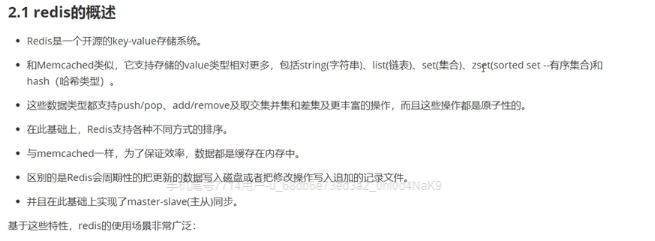
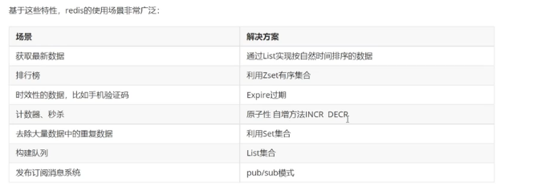

redis

# 1	NoSql数据库简介

# 2	redis的概述与安装

## 2.1	redis的概述





### 2.2	redis的安装

#### 2.2.1	前期准备

#### 2.2.2	安装步骤

### 2.3	redis启动

#### 2.3.1	redis前台启动

#### 2.3.2	redis后台启动

```
llen key		//获取集合长度
linsert key before s v		#在k2列表中的s2元素前面追加元素v2,返回
```


# 3

# 4

# 5